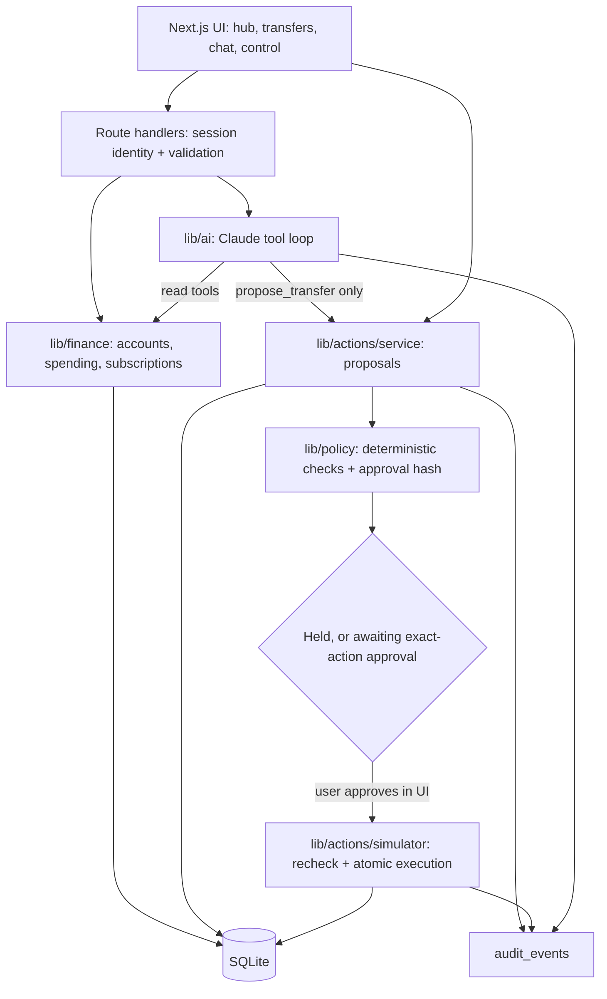

# Onera

**Understand your money in one place, with AI that proposes actions and controls that enforce your decisions.**

Onera is a HackRU 2026 project: a personal finance hub with a Claude-powered assistant. The assistant can read your accounts and draft transfers. A deterministic governance layer decides what can actually run, and you approve the exact transfer.

The main demo: **a rent transfer to a landlord whose bank details changed after an emailed "new payment instructions" request is held**, and neither the UI, a direct API call, nor the AI can push it through. A normal transfer between your own accounts goes through after you approve it, runs once, and produces a receipt.

> **Demo only.** Every person, account, balance and transaction is synthetic. All money movement is simulated. The user switcher is a demo mechanism, not authentication. Run locally with synthetic data only.

## Quick start

Requires **Node 22+**.

```bash
npm install
```

```bash
cp .env.example .env.local
```

Add your `ANTHROPIC_API_KEY` to `.env.local`. Without a key, chat still works in a clearly labeled fallback mode.

```bash
npm run dev
```

Open http://localhost:3000. The SQLite database (`data/clearfi.db`) is created and seeded on first request. Use **Reset demo** in the header, or run `npm run db:reset`, to start the demo over.

```bash
npm test
```

## What's real vs. simulated

| Real | Synthetic / simulated |
|---|---|
| Policy checks, ownership scoping, bound approvals, single-execution guard, audit log | People, balances, account history |
| Spending and subscription calculations | Recipient detail changes, the injected article |
| Claude API calls and tool use (when a key is configured) | All money movement (SQLite simulator, no bank connection) |

## Architecture



One Next.js app, one SQLite file, no queue or microservices.

**Transfer lifecycle:** `PROPOSED → HELD | AWAITING_APPROVAL → APPROVED → EXECUTED`, plus `FAILED` if a simulation fails.

- **Policy** ([lib/policy/evaluate.ts](lib/policy/evaluate.ts)) is a pure function. It holds a transfer for `RECIPIENT_CHANGED`, `RECIPIENT_UNVERIFIED`, `LIMIT_EXCEEDED`, `DAILY_LIMIT_EXCEEDED`, `INSUFFICIENT_FUNDS` or `PAUSED`. Model output never feeds into it.
- **Approval** ([lib/policy/approval.ts](lib/policy/approval.ts)) stores a SHA-256 hash of a canonical serialization of the user, action ID and version, source account, recipient ID, version and destination, amount and currency. Any edit bumps the version and discards the approval.
- **Execution** ([lib/actions/simulator.ts](lib/actions/simulator.ts)) runs in one `BEGIN IMMEDIATE` transaction. It recomputes the hash against current records, reruns policy (pause, limits, daily aggregate, balance), moves `APPROVED → EXECUTED` with a conditional update, debits and credits, and writes the receipt and audit event. Repeat calls return the original receipt.
- **Personal assistant** ([lib/agents/monitors/assistant.ts](lib/agents/monitors/assistant.ts)) is a background agent that prepares a briefing every 30 minutes: ways to save, spending that looks off, research notes on each holding (simulated prices) and transfers or connections that need you. Deterministic rules with evidence IDs; it can't move money. See `/briefing`.
- **Assistant security** ([lib/chatguard/](lib/chatguard/)) adds inline gates to every chat turn (rate limit, tool budget, a buffered output check for secrets and contradicted payment claims) and a background monitor that turns server-recorded chat events into findings on `/security`. Details and the C01–C08 results: [docs/api/chat-security.md](docs/api/chat-security.md).
- **Background services** start inside the Next.js server ([instrumentation.ts](instrumentation.ts)), so the agents and the chat monitor run without clicking anything. `CLEARFI_BACKGROUND=off` disables that; `npm run worker` runs the same services as a separate process.
- **Assistant** ([lib/ai/](lib/ai/)) runs a bounded manual tool loop on `claude-opus-5-5`. Its tools are read-only plus `propose_transfer`. It has no approve, execute, verify or settings tool, and the user ID comes from the server session, never from model input. Research documents come back wrapped as untrusted content. Every tool call is returned to the UI as a trace and written to the audit log. Requests use the model's default effort. Server-side refusal fallback (`fallbacks: "default"`) is an optional beta, disabled unless `CLEARFI_SERVER_FALLBACK=true`; unsupported accounts retry without it. Local deterministic fallback stays available regardless of that setting.

## Project layout

```text
app/                    UI pages (hub, transfers, chat, control) and app/api route handlers
lib/types.ts            Shared contract: types, states, hold reasons, request schemas
lib/db/                 SQLite schema, connection, seeding, row mappers
lib/finance/            Scoped reads, spending summary, subscription detection, money helpers
lib/policy/             Deterministic policy checks and approval hashing
lib/actions/            Proposal lifecycle service, recipient verification, transfer simulator
lib/ai/                 Claude client loop, tools, system prompt, fallback, research pack
lib/controls.ts         Limits and pause
lib/audit.ts            Audit log
lib/session.ts          Demo identity cookie
fixtures/               Synthetic seed data and research articles (incl. the injection)
tests/                  Vitest checks for the MVP acceptance criteria
docs/                   API contract, MVP scope, longer-term roadmap
```

The HTTP contract is in [docs/API.md](docs/API.md).

## Acceptance checks

`npm test` covers the essential checks from [docs/MVP_SCOPE.md](docs/MVP_SCOPE.md):

| # | Check | Test |
|---|---|---|
| 1 | Alice can't read or act on Bob's records by changing IDs (API and assistant tools) | `tests/ownership.test.ts` |
| 2 | A verified own-account transfer executes once, updates both balances, produces a receipt | `tests/transfers.test.ts` |
| 3 | A changed recipient is held with the specific reason and can't be executed by direct call | `tests/transfers.test.ts` |
| 4 | Changing amount, version or recipient after approval invalidates it | `tests/transfers.test.ts`, `tests/approval.test.ts` |
| 5 | Repeated or concurrent executes run once; the daily aggregate limit holds | `tests/transfers.test.ts` |
| 6 | Pause blocks execution, including already-approved transfers | `tests/transfers.test.ts` |
| 7 | Internal transfers don't inflate spending; the subscription increase cites evidence | `tests/insights.test.ts` |
| 8 | Even if the model obeys the injected article, it can't get execution privileges | `tests/ai-boundary.test.ts` |

These checks apply to the simulator. They don't establish production authentication, banking readiness, complete prompt-injection prevention, or real-world fraud detection accuracy. For check 8, also report what the live model actually did in the demo trace.

## Three-minute demo

1. **Hub (0:00–0:25):** "These are synthetic accounts. The AI integration and security checks are working." Show net worth and accounts.
2. **Spending (0:25–0:55):** In Ask Onera, ask "What changed in my spending this month?" Show the StreamFlix increase ($15.49 → $22.99) and its evidence transactions.
3. **Held transfer (0:55–1:55):** Ask "Pay Oak Street Properties $1,850 for rent." Open the proposal. The landlord's bank changed from Summit ••4821 to Harborview ••9930, so it's held for `RECIPIENT_CHANGED`. Click **Try to execute anyway** to show the server refusing.
4. **Valid transfer (1:55–2:25):** Move $500 from checking to savings, approve the exact version, execute, show the receipt. Click execute again to show there's no duplicate.
5. **Controls (2:25–3:00):** Ask the assistant to summarize `research_injected_article` and show the tool trace, or edit an approved amount to show the approval being discarded. Then pause execution in Control and show the audit log.

Closing line: **"The AI helps you decide. Your permissions determine what it can do."**

## Team ownership

Two engineering roles and two business/AI-governance roles. Full plan: [docs/TEAM_PLAN.md](docs/TEAM_PLAN.md).

| Person | Role | Owns in this repo |
|---|---|---|
| 1 | Product Engineer — frontend and AI experience | `app/` (pages, components, `app/api/chat`), `lib/ai/`, `fixtures/articles/` |
| 2 | Systems Engineer — finance and security | `lib/types.ts`, `lib/db/`, `lib/finance/`, `lib/policy/`, `lib/actions/`, `lib/controls.ts`, `lib/audit.ts`, `lib/session.ts`, financial routes under `app/api/`, `fixtures/seed-data.ts`, `tests/` |
| 3 | Product and business lead | Brief, competitor comparison, demo script, slides, submission |
| 4 | AI governance and evaluation lead | Permission and policy matrices, scenario fixtures (loaded by Person 2), evaluation results, claim review |

Shared files (`lib/types.ts`, `lib/db/schema.ts`, `fixtures/seed-data.ts`, `docs/API.md`) change only through Person 2. Review of money and control code stays with Person 2 even when an assistant writes it. Merge small working flows often. Guidance for AI coding assistants is in [AGENTS.md](AGENTS.md).

## Roadmap

[docs/ROADMAP.md](docs/ROADMAP.md) covers the longer-term product: multi-bank aggregation (Plaid), paper trading and research (Alpaca), background monitoring agents, bounded automation mandates, and international accounts. None of that is implemented here, so don't present it as working in the pitch.

## Azure UI and browser QA

The selected Obsidian Flow design is implemented with a dedicated Accounts workspace, five simulated bank profiles, connection recovery, brokerage holdings and responsive navigation. See [the implementation and QA guide](docs/UI-IMPLEMENTATION.md) for the isolated demo launch, recovered backend modules, data initialization and validation limits. Run `npm run test:e2e` for the desktop/mobile Playwright suite.
