# Onera

**One place to understand your money, with AI that proposes actions and controls that enforce your decisions.**

Onera is a HackRU 2026 personal finance hub with a Claude-powered assistant. The assistant can read your accounts, explain your spending, and *draft* transfers and paper trades. It cannot approve or execute anything. A deterministic governance layer decides what is allowed to run, and you approve the exact version of each action.

The signature demo: **a rent payment to a landlord whose bank details changed after an emailed "new payment instructions" request is held.** Neither the UI, a direct API call, nor the AI can push it through. A normal transfer between your own accounts goes through after you approve it, runs exactly once, and produces a receipt.

> **Demo only.** Every person, account, balance and transaction is synthetic. All bank money movement is simulated, and the user switcher is a demo mechanism, not authentication. Run it locally with synthetic data only. Trading uses Onera's simulated paper broker unless you configure Alpaca (see [Brokerage and market data](#brokerage-and-market-data)).

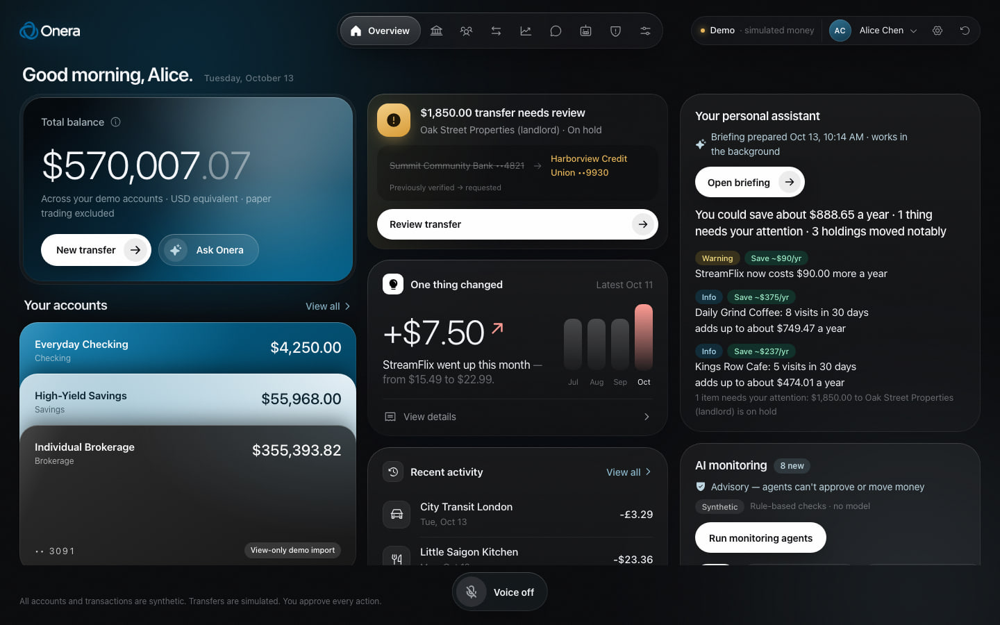

---

## Contents

- [What's in the app](#whats-in-the-app)
- [Screenshots](#screenshots)
- [Quick start](#quick-start)
- [Architecture](#architecture)
  - [System overview](#system-overview)
  - [The governed action lifecycle](#the-governed-action-lifecycle)
  - [The assistant and its tools](#the-assistant-and-its-tools)
  - [Chat security](#chat-security)
  - [Background agents](#background-agents)
  - [Modules](#modules)
  - [Data layer](#data-layer)
  - [Brokerage and market data](#brokerage-and-market-data)
  - [Cross-cutting: i18n, voice, errors](#cross-cutting-i18n-voice-errors)
- [Security invariants](#security-invariants)
- [What's real vs. simulated](#whats-real-vs-simulated)
- [Project layout](#project-layout)
- [Development](#development)
- [Tests and acceptance checks](#tests-and-acceptance-checks)
- [Three-minute demo](#three-minute-demo)
- [Documentation map](#documentation-map)
- [Team and roadmap](#team-and-roadmap)

---

## What's in the app

| Tab | Route | What it does |
|---|---|---|
| **Overview** | `/` | Net worth across USD/GBP/CAD/EUR, spending vs. last month, subscription price increases with evidence transactions, items that need attention. |
| **Accounts** | `/accounts` | Linked accounts from five simulated banks, connection health, recover/reconnect/disconnect, per-account workspace, brokerage holdings. |
| **Family** | `/family` | Kids' secondary cards on a parent's credit card: monthly and per-purchase limits, blocked categories, freeze, deterministic approve/decline. |
| **Transfers** | `/transfers` | Move money flow: propose, see the policy checks, approve the exact version, execute, receipt. Held transfers explain why. |
| **Trade** | `/trade` | Search any US stock or ETF, watchlist, price chart, order ticket with trading limits, hold-to-confirm. Orders go through the same propose, policy, approve, execute lifecycle. |
| **Assistant** | `/chat`, `/briefing` | "Ask Onera" chat with five scoped assistant agents, plus the personal assistant's background briefing. |
| **Agents** | `/agents` | A live map of the seven background agents: what each reads and writes, status (live, stale or offline), last run, and an activity feed. |
| **Security** | `/security` | Threat-monitor and security-sentinel findings from the audit log, plus the assistant security monitor's findings. |
| **Controls** | `/control` | Per-transfer and daily limits, the global pause, the audit log, and the agent permission matrix. |
| **Settings** | `/settings` | Accessibility and language (11 languages including Arabic RTL). |

A voice dock ("Talk to Onera") sits at the bottom of every page. It works once `ELEVENLABS_API_KEY` is set and otherwise shows "Voice off" with how to enable it. Bounded autonomous-trading mandates exist as an API only (`/api/mandates`), with no UI.

## Screenshots

All data is synthetic and every transfer is simulated. Captured at 1440×900 from a freshly reset demo.

<table>
  <tr>
    <td width="50%">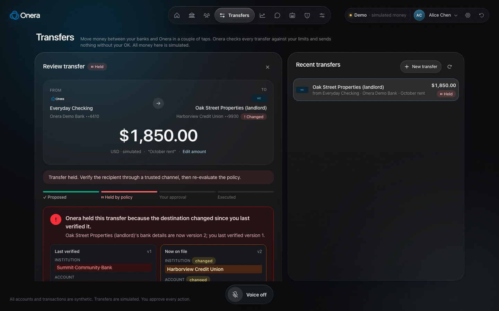<br><b>Transfers.</b> The rent payment is held: the landlord's bank details changed after verification, and Onera shows exactly what changed.</td>
    <td width="50%">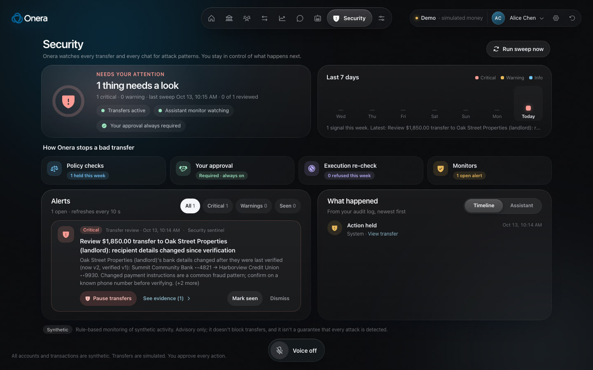<br><b>Security.</b> One look tells you if you're OK, then the four layers that stop a bad transfer, alerts and what happened.</td>
  </tr>
  <tr>
    <td>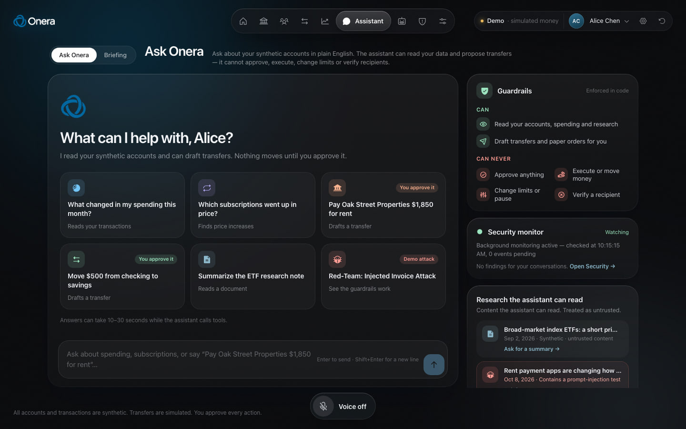<br><b>Ask Onera.</b> Starter prompts, including a red-team prompt-injection demo, next to what the assistant can and can never do.</td>
    <td>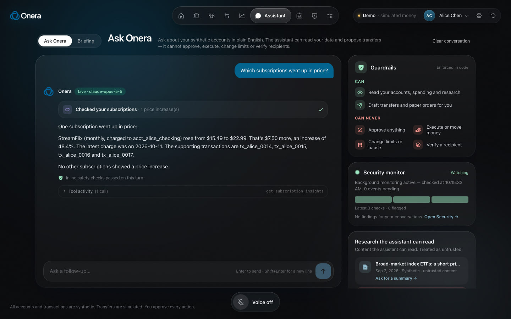<br><b>A live reply.</b> Each tool the assistant used, the answer, and the inline safety check for the turn.</td>
  </tr>
  <tr>
    <td>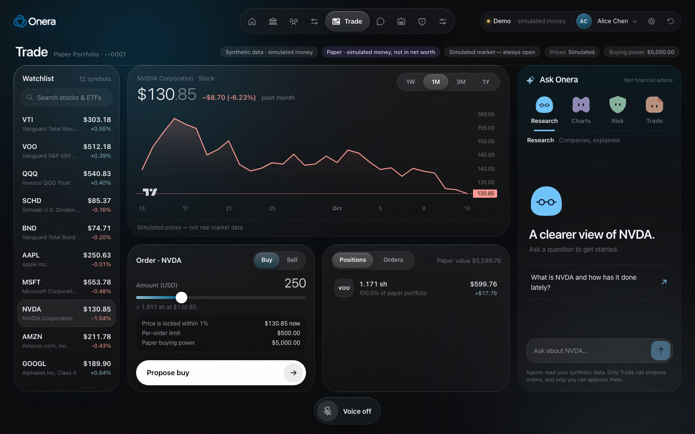<br><b>Trade.</b> Paper trading on one screen: watchlist, chart, order ticket with limits, positions and four research agents.</td>
    <td>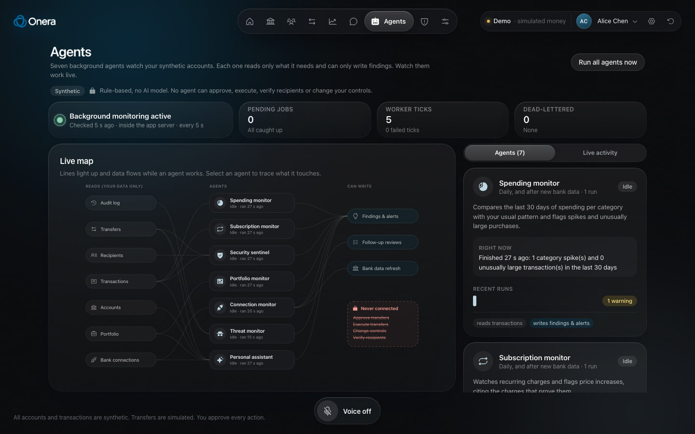<br><b>Agents.</b> A live map of the seven background agents, what each reads, and the actions none of them can take.</td>
  </tr>
  <tr>
    <td>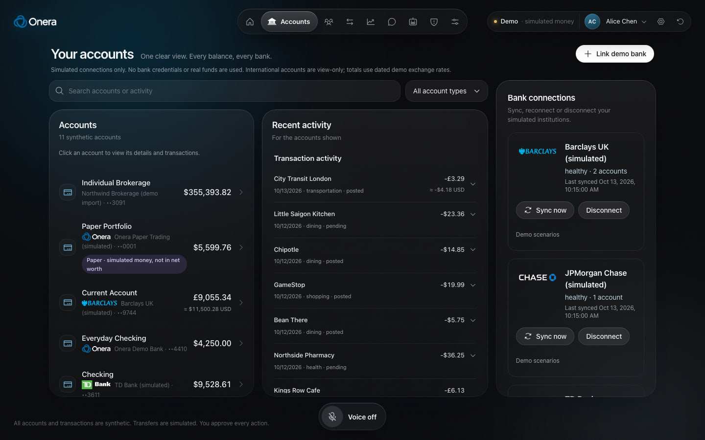<br><b>Accounts.</b> Linked accounts from simulated banks, connection health and per-account activity.</td>
    <td>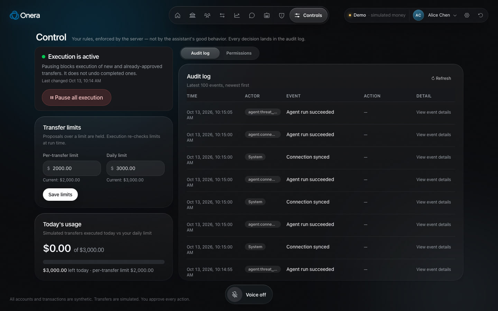<br><b>Controls.</b> The global pause, per-transfer and daily limits, and the audit log.</td>
  </tr>
</table>

<p align="center">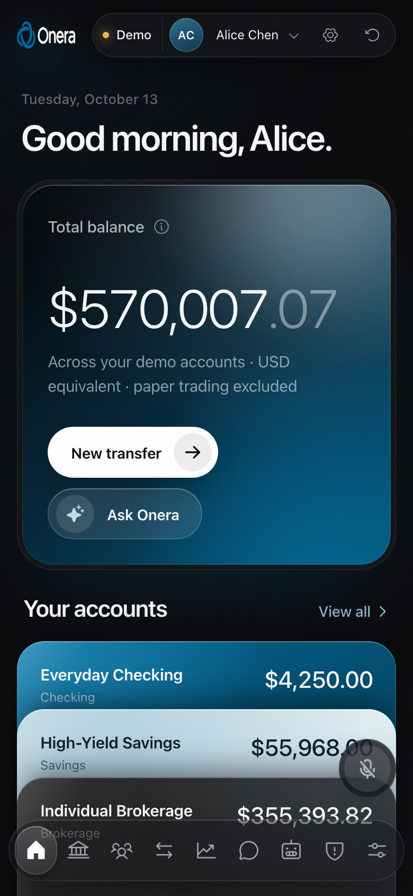<br><b>Phone.</b> The same app at 390px wide.</p>

---

## Quick start

Requires **Node 22+**.

```bash
npm install
cp .env.example .env.local
```

Add your `ANTHROPIC_API_KEY` to `.env.local`. Without a key the chat still works in a clearly labeled deterministic fallback mode, and nothing else needs a key.

```bash
npm run dev
```

Open <http://localhost:3000>. The SQLite database (`data/clearfi.db`) is created and seeded on the first request. Use **Reset demo** in the header, or `npm run db:reset`, to start over.

```bash
npm test
```

> Internal identifiers keep the project's earlier name `clearfi` (package name, database file, `CLEARFI_*` environment variables). The product is Onera.

### Configuration

All keys are server-side only and optional. See [.env.example](.env.example) for the full list.

| Variable | Default | Purpose |
|---|---|---|
| `ANTHROPIC_API_KEY` | – | Live Claude chat. Missing: labeled fallback replies. |
| `CLEARFI_MODEL` | `claude-opus-5-5` | Assistant model. |
| `CLEARFI_AI_MODE` | `live` | Set to `fallback` to force the deterministic fallback for offline demos. |
| `CLEARFI_SERVER_FALLBACK` | `false` | Optional Anthropic server-side refusal-fallback beta. |
| `ELEVENLABS_API_KEY` | – | Voice: speech-to-text (Scribe) and spoken replies. |
| `ALPACA_API_KEY_ID`, `ALPACA_API_SECRET_KEY` | – | Real market data and brokerage. Blank means simulated market. |
| `ALPACA_ENV` | `paper` | `paper` or `live`. Live also needs `ALPACA_ALLOW_LIVE_TRADING=true` and caps each order (`ALPACA_LIVE_MAX_ORDER_CENTS`, default $100). |
| `CLEARFI_DB_PATH` | `./data/clearfi.db` | SQLite file. |
| `CLEARFI_BACKGROUND` | `on` | `off` stops the in-process agents and monitors (use `npm run worker` instead). |
| `CLEARFI_CHAT_RATE_LIMIT` | `12` | Chat requests per user per minute. |
| `CLEARFI_CHAT_REVIEWER` | `on` | Optional AI reviewer for ambiguous chat security events. |

---

## Architecture

One Next.js app, one SQLite file, no queue service and no microservices. Everything that matters for safety happens on the server, in plain TypeScript that tests exercise directly.

### System overview

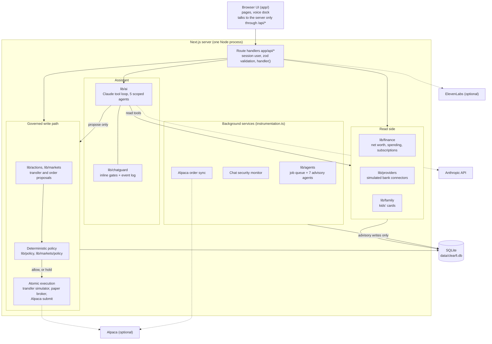

**Trust boundaries.** The browser is untrusted: it never supplies a user ID and never sees an approval hash. The model is untrusted: it only reaches data through tools that the server scopes to the session user, and it can only *propose*. Documents and web-style content the assistant reads are untrusted data, wrapped as such. The only trusted decision-makers are deterministic server code and the signed-in user's explicit approval.

### The governed action lifecycle

Every transfer and every order follows the same path: **propose, evaluate with deterministic policy, approve the exact version, execute once, audit.**

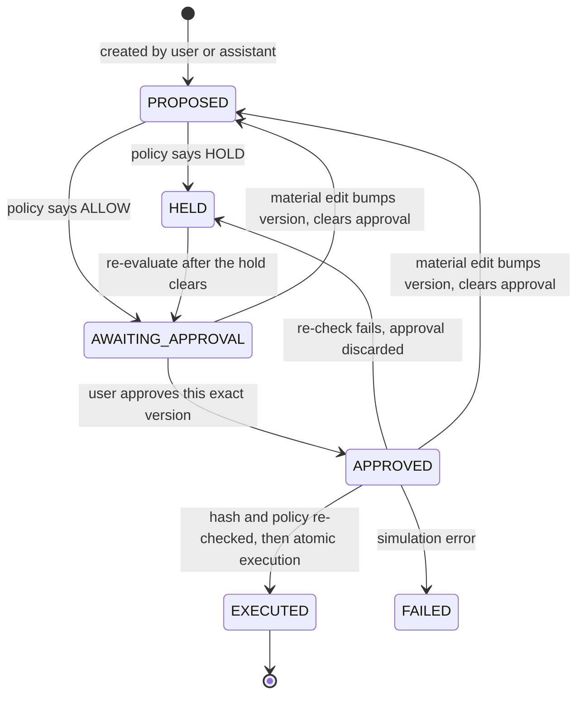

Orders add broker states: `APPROVED → SUBMITTING → SUBMITTED → EXECUTED | CANCELED | FAILED`, since an Alpaca order fills later.

- **Policy** ([lib/policy/evaluate.ts](lib/policy/evaluate.ts)) is a pure function of stored records and user controls. It holds a transfer for `RECIPIENT_CHANGED`, `RECIPIENT_UNVERIFIED`, `LIMIT_EXCEEDED`, `DAILY_LIMIT_EXCEEDED`, `INSUFFICIENT_FUNDS` or `PAUSED`. Order policy ([lib/markets/policy.ts](lib/markets/policy.ts)) adds instrument, quote, price-bound, cash/share and mandate checks. Model output never feeds into either.
- **Approval** ([lib/policy/approval.ts](lib/policy/approval.ts)) stores a SHA-256 hash of a canonical serialization of the user, action ID and version, source account, recipient ID/version/destination, amount and currency. Any edit bumps the version and discards the approval. The client sends only the version it saw, never a hash.
- **Execution** ([lib/actions/simulator.ts](lib/actions/simulator.ts)) runs in one `BEGIN IMMEDIATE` transaction. It recomputes the hash against current records, reruns policy (pause, limits, daily aggregate, balance), claims `APPROVED → EXECUTED` with a conditional update, debits and credits, and writes the receipt and audit event. Repeated or concurrent calls return the original receipt. Orders use the same pattern in [lib/markets/broker.ts](lib/markets/broker.ts).
- **Audit** ([lib/audit.ts](lib/audit.ts)) records every proposal, decision, approval, execution, refusal, agent run and assistant tool call.

How the signature demo plays out end to end:

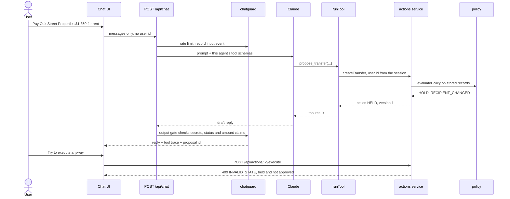

### The assistant and its tools

[lib/ai/chat.ts](lib/ai/chat.ts) runs a bounded manual tool loop (8 iterations, 16 tool calls per turn) on `claude-opus-5-5`. The reply is fully buffered and checked before release, never streamed. Every tool call is returned to the UI as a trace and written to the audit log.

The assistant has **read tools plus exactly two proposal tools** ([lib/ai/tools.ts](lib/ai/tools.ts)): `propose_transfer` and `propose_order`. There is no tool that approves, executes, verifies a recipient, changes a limit, or pauses. Each assistant agent gets a subset of those tools, enforced twice: only its schemas are sent to the model, and `runTool` refuses anything outside `ToolContext.allowedTools`.

| Agent (`lib/ai/agents.ts`) | Tools |
|---|---|
| **Onera assistant** (`general`) | All read tools and `propose_transfer`. Not `propose_order`. |
| **Research analyst** | `get_quotes`, `get_price_history`, `get_research_document` |
| **Chart reader** | `get_quotes`, `get_price_history` |
| **Risk checker** | `get_portfolio`, `get_quotes`, `get_trading_controls`, `get_agent_insights` |
| **Trade drafter** | `get_portfolio`, `get_quotes`, `get_trading_controls`, `propose_order` |

Read tools: `get_accounts`, `get_transactions`, `get_spending_summary`, `get_subscription_insights`, `list_recipients`, `get_research_document`, `get_connections`, `get_portfolio`, `get_quotes`, `get_price_history`, `get_trading_controls`, `get_agent_insights`.

Research documents come back wrapped as untrusted content, and instruction-like text inside them is detected and logged ([lib/security/injection.ts](lib/security/injection.ts)). Detection only labels events; it never drives a policy decision.

When the model is unavailable, [lib/ai/fallback.ts](lib/ai/fallback.ts) answers from the same deterministic calculations. Fallback replies are labeled, are read-only, and never create proposals.

### Chat security

[lib/chatguard](lib/chatguard) puts inline gates in front of every reply and tool result, and runs a background monitor that explains what happened afterwards.

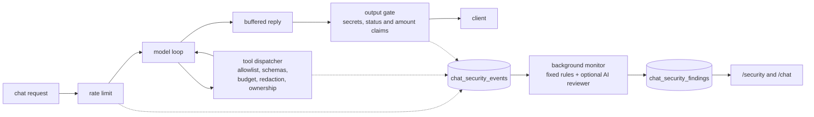

Prevention is inline. The monitor never blocks anything; it cannot undo a disclosure, and an AI reviewer opinion can never *confirm* a violation (a database CHECK enforces it). Events are written by server code only, with redacted excerpts. The C01–C08 scenarios and full contracts are in [docs/api/chat-security.md](docs/api/chat-security.md).

### Background agents

Seven agents run on a durable job queue ([lib/agents](lib/agents)) with dedupe, retries and dead-lettering. None of them can approve, execute, create mandates, verify recipients or change controls, and none uses a model. Their permission matrix is code ([lib/agents/registry.ts](lib/agents/registry.ts)); the runner builds each handler's context from it, so a read or write outside the list throws, fails the run and is audited.

| Agent | Watches | Trigger |
|---|---|---|
| Spending monitor | Category spikes, unusually large purchases | Daily, and after a bank sync |
| Subscription monitor | Recurring-charge price increases, with proof | Daily, and after a bank sync |
| Security sentinel | Each transfer proposal: changed recipient, first-time external payee, outsized amount | Every new proposal |
| Portfolio monitor | Concentration above 25% of an account, big daily moves | Daily |
| Connection monitor | Refreshes healthy connections, raises sync failures | Every 15 minutes per connection |
| Threat monitor | Attack patterns in the audit log (not-found probes, stale-approval replays, limit probing, injection attempts) | After new activity |
| Personal assistant | Ways to save, spending that looks off, holdings notes, items needing you | Every 30 minutes per user, or on demand |

They start inside the Next.js server ([instrumentation.ts](instrumentation.ts) → [lib/background.ts](lib/background.ts)) alongside the chat security monitor and the Alpaca order sync, so nothing needs clicking. `npm run worker` runs the same services as a separate process, and running both is safe because jobs are claimed atomically with leases. The Agents tab shows each service as live, stale or offline from a worker heartbeat.

### Modules

Feature modules own their directory, tables and seed data. They call each other only through their `index.ts` and register tables through their own `db.ts` ([lib/db/modules.ts](lib/db/modules.ts)), never by editing the core schema.

| Module | Path | Responsibility |
|---|---|---|
| Core | `lib/types.ts`, `lib/db`, `lib/policy`, `lib/actions`, `lib/controls.ts`, `lib/audit.ts`, `lib/session.ts` | Shared contract, schema, transfer lifecycle, policy, approval hashing, simulator, limits and pause, audit log, demo identity |
| Finance | `lib/finance` | Scoped reads, net worth with dated demo FX, spending (internal transfers excluded), subscription detection, money helpers |
| Providers | `lib/providers` | Five simulated bank connectors, link/sync/disconnect, idempotent cursor sync, connection health, internal-transfer matching |
| Markets | `lib/markets` | Quotes, history, search and watchlist, portfolio, order lifecycle, mandates, Onera paper broker, Alpaca brokerage |
| Agents | `lib/agents` | Job queue, scheduler, worker, monitors, insights, run log, permission registry |
| Family | `lib/family` | Kids' cards, deterministic purchase rules, alerts |
| Chatguard | `lib/chatguard` | Inline gates, security events, background monitor, findings, optional AI reviewer |
| AI | `lib/ai` | Claude loop, tools, agents, prompt, fallback, research pack |
| Security helpers | `lib/security` | Injection markers, secret redaction |
| Voice | `lib/voice` | ElevenLabs transcription and speech (transport only) |
| i18n | `lib/i18n` | Message catalog, 10 locale dictionaries, server and client translators |

### Data layer

[better-sqlite3](https://github.com/WiseLibs/better-sqlite3) in WAL mode with foreign keys on. The schema is versioned by `SCHEMA_VERSION` ([lib/db/schema.ts](lib/db/schema.ts)); when it changes the local database is rebuilt and reseeded rather than migrated, since it only holds synthetic data. Tests use fresh in-memory databases (`freshDb()` in [tests/helpers.ts](tests/helpers.ts)).

| Owner | Tables |
|---|---|
| Core | `users`, `accounts`, `transactions`, `recipients`, `actions`, `user_controls`, `audit_events`, `fx_rates` |
| Providers | `connections` |
| Markets | `positions`, `trading_controls`, `mandates`, `orders`, `broker_links`, `watchlist`, `market_assets`, `market_quotes`, `market_bars`, `market_data_state` |
| Agents | `jobs`, `insights`, `agent_runs`, `worker_heartbeats` |
| Family | `family_members`, `family_cards`, `family_charges` |
| Chatguard | `chat_security_events`, `chat_security_findings`, `chat_security_finding_events`, `chat_monitor_state`, `chat_monitor_failures` |

Money is integer cents plus `"USD"`; share quantities are integer micro-shares; FX uses integer `rate_micros`. No floats touch an amount.

### Brokerage and market data

Three modes, chosen by configuration:

| Mode | Prices | Where orders fill |
|---|---|---|
| **Simulated** (default) | Deterministic simulator, always open, labeled "Simulated prices" | Onera paper broker (SQLite) |
| **Alpaca paper** | Real Alpaca market data (IEX feed by default) | Submitted to your Alpaca paper account |
| **Alpaca live** | Real market data | Only with `ALPACA_ALLOW_LIVE_TRADING=true`; orders you create yourself, each capped (default $100) |

Alpaca orders are sent as **limit orders at the approved price bound** (day only, no extended hours), so the broker enforces the price you saw. Submission is idempotent through `client_order_id = "<id>-v<version>"`, and an ambiguous failure is reconciled by lookup rather than re-posting. Cash and positions are mirrored into the local tables so policy and agents read them synchronously. Onera never trades on margin.

**Mandates** let a background agent place bounded paper BUY orders on Onera paper accounts only: capped per order and per day, at most 90 days, revocable. Only the signed-in user can create or revoke one, and mandates never apply to an Alpaca account.

### Cross-cutting: i18n, voice, errors

- **i18n.** The English text in code is the translation key. Client components use `const { t, tp, tr } = useI18n()`; module-level constants use `msg("…")`; server components use `getServerT()`. `npm test` fails if any message is missing from a locale in `lib/i18n/locales/`. List gaps with `npx tsx scripts/i18n-missing.ts <code>`.
- **Voice.** Transport only. The browser records audio, `/api/voice/transcribe` returns text, a deterministic router ([app/components/voiceIntent.ts](app/components/voiceIntent.ts)) picks navigation or an assistant agent, and the transcript goes to `POST /api/chat` exactly like typed text. Same tools, same approvals.
- **Errors.** Services throw `ServiceError` ([lib/errors.ts](lib/errors.ts)); every route is wrapped with `handler()` ([lib/http.ts](lib/http.ts)), which maps errors to `{ error: { code, message } }` and audits refused requests under the caller's own user.

---

## Security invariants

These are the properties the project is built around. [AGENTS.md](AGENTS.md) lists them for AI coding assistants; tests enforce them.

| # | Invariant | Where it's enforced |
|---|---|---|
| 1 | Money is integer cents + `"USD"`; floats are for display only | `lib/finance/money.ts`, `lib/markets/math.ts` |
| 2 | The user ID comes from the server session, never from a body, query string or model input; every private query filters on `user_id` | `lib/session.ts`, `ToolContext.userId`, all services |
| 3 | Another user's record is "not found" (404), never "forbidden" | services, `tests/ownership.test.ts` |
| 4 | The assistant has read tools plus `propose_transfer` and `propose_order` only; each agent gets a subset | `lib/ai/tools.ts`, `lib/ai/agents.ts`, `tests/ai-boundary.test.ts`, `tests/ai-agents.test.ts` |
| 5 | All writes go through `lib/actions/service.ts` and `lib/actions/simulator.ts` (and the `lib/markets` equivalents) | module `index.ts` exports deliberately omit privileged paths |
| 6 | Approvals bind to an exact version; a material edit bumps `version` and clears `approval_hash` | `lib/policy/approval.ts`, `tests/approval.test.ts` |
| 7 | Policy is deterministic; model output never feeds a policy decision | `lib/policy/evaluate.ts`, `lib/markets/policy.ts` |
| 8 | Synthetic and simulated labels stay visible; fallback replies are labeled and never create proposals | UI, `lib/ai/fallback.ts` |
| 9 | No secrets in the repo; keys live in gitignored `.env.local` | `.gitignore` |

---

## What's real vs. simulated

| Real | Synthetic or simulated |
|---|---|
| Policy checks, ownership scoping, bound approvals, single-execution guard, audit log | People, balances, account history |
| Spending, subscription and FX-converted net worth calculations | Recipient detail changes, the injected article |
| Claude API calls and tool use (with a key) | All bank money movement (SQLite simulator, no bank connection) |
| Job queue, background agents, chat security gates and monitor | The five bank connectors (TD Bank, Bank of America, JPMorgan Chase, Barclays UK, RBC) are modeled on how aggregators expose banks, not affiliated, no real connection |
| Alpaca market data and orders (when you configure keys) | Stock prices in default mode; demo FX rates; recipient verification |

Claims to avoid in a pitch: "connected to Chase", "prevents fraud", "immune to prompt injection", "trades autonomously". The accurate versions, and the full feature-by-feature evidence list, are in [docs/FEATURES.md](docs/FEATURES.md).

---

## Project layout

```text
app/
  api/                  Route handlers (one folder per resource; contract in docs/API.md)
  components/           Shared UI: Header, cards, money display, session + i18n contexts, voice dock
  accounts/ family/ transfers/ trade/ chat/ briefing/ agents/ security/ control/ settings/
                        One folder per page: page.tsx (server) + <Name>Client.tsx + page CSS
  page.tsx              Overview
lib/
  types.ts              Shared contract: types, states, hold reasons, request schemas
  db/                   Connection, core schema, seeding, row mappers, module registry
  actions/              Transfer lifecycle service, recipient verification, transfer simulator
  policy/               Deterministic transfer policy, approval hashing, hold messages
  finance/              Scoped reads, net worth + FX, spending, subscriptions, money helpers
  providers/            Simulated bank connectors and the sync engine
  markets/              Quotes, search, portfolio, orders, mandates, paper broker, Alpaca
  agents/               Job queue, scheduler, worker, monitors, insights, permission registry
  ai/                   Claude loop, tools, agent definitions, prompt, fallback, research pack
  chatguard/            Inline gates, security events, monitor, findings, AI reviewer
  family/               Kids' cards and purchase rules
  security/             Injection markers and redaction
  voice/                ElevenLabs transport
  i18n/                 Message catalog, translators, 10 locale dictionaries
  controls.ts audit.ts session.ts errors.ts http.ts background.ts
fixtures/               Synthetic seed data, governance scenarios, research articles (incl. the injection)
tests/                  Vitest suites (in-memory seeded database)
e2e/                    Playwright browser suite (desktop + mobile)
scripts/                reset-db, worker, i18n tooling
docs/                   API contract, backend plan, feature evidence, scope, roadmap, design notes
instrumentation.ts      Starts background services with the Next.js server
```

---

## Development

| Command | What it does |
|---|---|
| `npm run dev` | Dev server on port 3000 (starts background services too) |
| `npm run build` / `npm start` | Production build (webpack) and server |
| `npm run typecheck` | `tsc --noEmit` |
| `npm test` | Vitest: all unit, service, route and i18n-completeness tests |
| `npm run test:e2e` | Playwright on desktop and mobile Chromium, isolated database, simulated market, background services off |
| `npm run db:reset` | Wipe and reseed `data/clearfi.db` |
| `npm run worker` | Run the agents and chat monitor as a separate process (`-- --once`, `-- --limit 50`) |

Before pushing: `npm run typecheck && npm test`.

Conventions worth knowing:

- UI code talks to the server only through `/api/*`. Never import `lib/db`, `lib/actions` or `lib/ai` into a client component.
- New state-changing logic needs a Vitest test using `freshDb()`.
- Adding a feature module: create `lib/<module>/` with an `index.ts` public surface and a `db.ts` that exports a `DbModule`, then add it to `lib/db/modules.ts`. Bump `SCHEMA_VERSION` for schema changes.
- This repo uses a recent Next.js with breaking changes from older versions. Read the relevant guide in `node_modules/next/dist/docs/` before changing framework-level code.
- Delegating to subagents: [docs/agents/SUBAGENT_DELEGATION.md](docs/agents/SUBAGENT_DELEGATION.md).

---

## Tests and acceptance checks

The suite is ~380 Vitest tests across 38 files, plus Playwright e2e. The essential checks from [docs/MVP_SCOPE.md](docs/MVP_SCOPE.md):

| # | Check | Test |
|---|---|---|
| 1 | Alice can't read or act on Bob's records by changing IDs (API and assistant tools) | `tests/ownership.test.ts` |
| 2 | A verified own-account transfer executes once, updates both balances, produces a receipt | `tests/transfers.test.ts` |
| 3 | A changed recipient is held with the specific reason and can't be executed by direct call | `tests/transfers.test.ts` |
| 4 | Changing amount, version or recipient after approval invalidates it | `tests/transfers.test.ts`, `tests/approval.test.ts` |
| 5 | Repeated or concurrent executes run once; the daily aggregate limit holds | `tests/transfers.test.ts` |
| 6 | Pause blocks execution, including already-approved transfers | `tests/transfers.test.ts` |
| 7 | Internal transfers don't inflate spending; the subscription increase cites evidence | `tests/insights.test.ts` |
| 8 | Even if the model obeys the injected article, it can't get execution privileges | `tests/ai-boundary.test.ts` |

Beyond the MVP checks: order lifecycle, mandates and Alpaca (`tests/markets*.test.ts`), the agent permission registry and queue (`tests/agents*.test.ts`), chat gates and the C01–C08 scenarios (`tests/chatguard-*.test.ts`), per-assistant tool scoping (`tests/ai-agents.test.ts`), and governance scenarios replayed through the real services (`tests/scenarios.test.ts` runs [fixtures/scenarios.ts](fixtures/scenarios.ts), described in [docs/SCENARIOS.md](docs/SCENARIOS.md)).

These checks apply to the simulator. They don't establish production authentication, banking readiness, complete prompt-injection prevention, or real-world fraud detection accuracy. For check 8, also report what the live model actually did in the demo trace.

---

## Three-minute demo

1. **Hub (0:00–0:25):** "These are synthetic accounts. The AI integration and security checks are working." Show net worth and accounts.
2. **Spending (0:25–0:55):** In Ask Onera, ask "What changed in my spending this month?" Show the StreamFlix increase ($15.49 → $22.99) and its evidence transactions.
3. **Held transfer (0:55–1:55):** Ask "Pay Oak Street Properties $1,850 for rent." Open the proposal. The landlord's bank changed from Summit ••4821 to Harborview ••9930, so it's held for `RECIPIENT_CHANGED`. Click **Try to execute anyway** to show the server refusing.
4. **Valid transfer (1:55–2:25):** Move $500 from checking to savings, approve the exact version, execute, show the receipt. Click execute again to show there's no duplicate.
5. **Controls (2:25–3:00):** Ask the assistant to summarize `research_injected_article` and show the tool trace, or edit an approved amount to show the approval being discarded. Then pause execution in Control and show the audit log.

Closing line: **"The AI helps you decide. Your permissions determine what it can do."**

Optional extras: say "Buy $250 of NVDA in my paper account" to the voice dock (the Trade drafter proposes, you approve), or open **Family** and simulate a gaming purchase on Leo's blocked-category card.

---

## Documentation map

| Doc | What's in it |
|---|---|
| [docs/API.md](docs/API.md) | HTTP contract for every route |
| [docs/api/](docs/api) | Per-module contracts: [providers](docs/api/providers.md), [markets](docs/api/markets.md), [agents](docs/api/agents.md), [family](docs/api/family.md), [chat security](docs/api/chat-security.md) |
| [docs/BACKEND_PLAN.md](docs/BACKEND_PLAN.md) | Module architecture, shared contract, invariants every module keeps |
| [docs/FEATURES.md](docs/FEATURES.md) | What's real, simulated and roadmap, with test evidence. Use it for the pitch |
| [docs/SCENARIOS.md](docs/SCENARIOS.md) | Governance scenarios and expected outcomes |
| [docs/MVP_SCOPE.md](docs/MVP_SCOPE.md) | The hackathon scope lock |
| [docs/ROADMAP.md](docs/ROADMAP.md) | Longer-term product plan (Plaid, licensed data, real payments) |
| [docs/UI-IMPLEMENTATION.md](docs/UI-IMPLEMENTATION.md) | UI implementation notes, isolated demo launch, browser QA |
| [docs/SUBMISSION.md](docs/SUBMISSION.md) | Submission draft |
| [docs/TEAM_PLAN.md](docs/TEAM_PLAN.md) | Roles and ownership |
| [AGENTS.md](AGENTS.md) | Rules for AI coding assistants working in this repo |

---

## Team and roadmap

Two engineering roles and two business/AI-governance roles ([docs/TEAM_PLAN.md](docs/TEAM_PLAN.md)). Shared files (`lib/types.ts`, `lib/db/schema.ts`, `fixtures/seed-data.ts`, `docs/API.md`) change only through the systems owner, and review of money and control code stays with them even when an AI assistant writes it.

[docs/ROADMAP.md](docs/ROADMAP.md) covers what comes next: real account aggregation (Plaid) behind the existing connector interface, licensed market data, a payment partner for real transfers, production authentication, and international corridors. None of that is built here, so don't present it as working.
