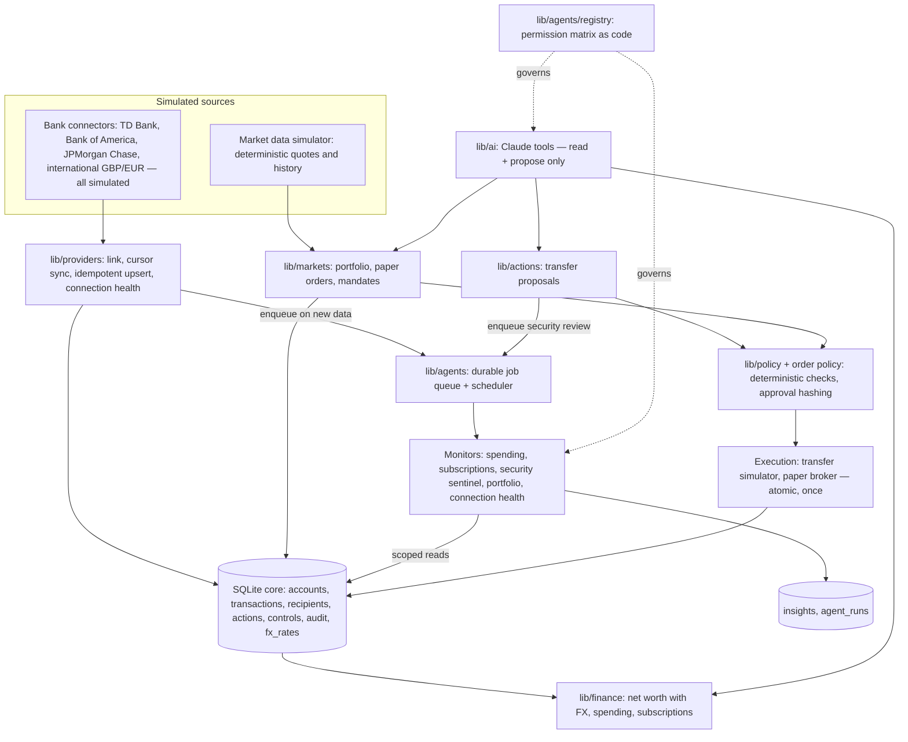

# Onera backend plan

How the backend grows from the transfer-governance MVP to the full idea (multi-bank hub, investments, AI research, async monitoring agents, AI governance) without destabilizing the demo.

**Rule:** every feature is a module under `lib/<module>/` that plugs into the existing spine. Nothing that moves money or places orders bypasses policy, exact-action approval (or a bounded mandate), the single-execution guard and the audit log. Everything external is **simulated** and labeled as such.

## Target architecture

## Modules and ownership

| Module | Path | What it does | Status |
|---|---|---|---|
| Core | `lib/db`, `lib/types.ts`, `lib/finance`, `lib/policy`, `lib/actions`, `lib/controls.ts`, `lib/audit.ts` | Schema, demo identities, transfers, policy, approvals, simulator, FX, net worth | Built |
| Providers | `lib/providers/`, `app/api/institutions`, `app/api/connections` | Simulated bank connectors (TD Bank, Bank of America, JPMorgan Chase, an international bank), link/sync/disconnect, connection health, idempotent cursor sync, internal-transfer matching | Workstream A |
| Markets | `lib/markets/`, `app/api/markets`, `app/api/portfolio`, `app/api/orders`, `app/api/mandates` | Simulated quotes and history, holdings, paper orders through the same propose → policy → approve → execute lifecycle, bounded mandates for autonomous paper trading | Workstream B |
| Agents | `lib/agents/`, `app/api/agents`, `scripts/worker.ts` | Durable job queue with dedupe, retries and dead-lettering; scheduler; monitors; persisted insights with evidence; agent run log; agent registry (permission matrix in code) | Workstream C |
| AI | `lib/ai/` (Person 1) | Chat tools call the public module surfaces above: portfolio, quotes, insights, connections | After A–C merge |

## Shared contract (frozen for the parallel build)

Modules talk to each other only through `lib/<module>/index.ts`. Signatures there are a contract; change them only through the systems owner.

| Surface | Signature |
|---|---|
| `@/lib/providers` | `listInstitutions()`, `listConnections(db, userId)`, `linkInstitution(db, userId, institutionId, now?)`, `syncConnection(db, userId, connectionId, now?) → SyncSummary`, `disconnectConnection(db, userId, connectionId)` |
| `@/lib/markets` | `listInstruments()`, `getQuote(symbol, now?) → Quote \| null`, `getPortfolio(db, userId, now?) → Portfolio` |
| `@/lib/agents` | `enqueueJob(db, JobInput) → EnqueueResult` (also `@/lib/agents/queue`), `runPendingJobs(db, { limit?, now? }) → RunReport` |

Each module registers its tables and seed data in [`lib/db/modules.ts`](../lib/db/modules.ts) via its own `lib/<module>/db.ts`. Bump `SCHEMA_VERSION` in `lib/db/schema.ts` when schema changes; local demo databases are rebuilt automatically.

Core changes already made for the modules:

- `accounts`: `connection_id`, `external_id`, `is_paper`; types now include `credit`; currencies `USD | EUR | GBP | CAD`; capability `trade`.
- `transactions`: `provider_tx_id` with a unique index per account, so repeated syncs never duplicate rows.
- `fx_rates`: dated synthetic rates; net worth and spending convert to USD.
- Net worth excludes paper accounts and adds brokerage positions from `getPortfolio`.
- Transfers stay USD-only between bank accounts; paper and foreign-currency accounts are rejected.
- `createTransfer` enqueues an advisory `security_review` job.

## Invariants every module keeps

1. User ID comes from the server session; every query filters on `user_id`; other users' records are 404.
2. Money is integer cents; share quantities are integer micro-shares; FX uses integer `rate_micros`.
3. Financial writes go through a proposal → deterministic policy → exact-action approval (or a valid, unexpired, unrevoked mandate) → atomic single execution → audit event.
4. Agents and the assistant can read within their registered scope and propose. They can never approve, execute, create mandates, verify recipients or change controls. An agent cannot approve its own proposal.
5. The global pause in `user_controls` blocks every new execution: transfers, orders and mandate-driven trades.
6. Simulated institutions are labeled "(simulated)", with a disclaimer that there is no affiliation or real connection. Paper trading is labeled paper.
7. Tests use `freshDb()` (in-memory). Core tests must keep passing.

## Path to real integrations (after the hackathon)

| Simulated now | Real later |
|---|---|
| Bank connectors | Aggregator adapter (e.g. Plaid) behind the same `lib/providers` interface; verified webhooks + periodic reconciliation |
| Market data | Licensed market-data feed behind `getQuote` |
| Paper broker | Broker paper API, then a brokerage partner for customer accounts |
| Transfer simulator | Payment partner that supports the specific transfer flow |
| Demo FX | Dated FX quotes from a provider, with fees and expiry |

Each of these needs partner approval, compliance review and production auth before real money is involved. See [ROADMAP.md](ROADMAP.md).
