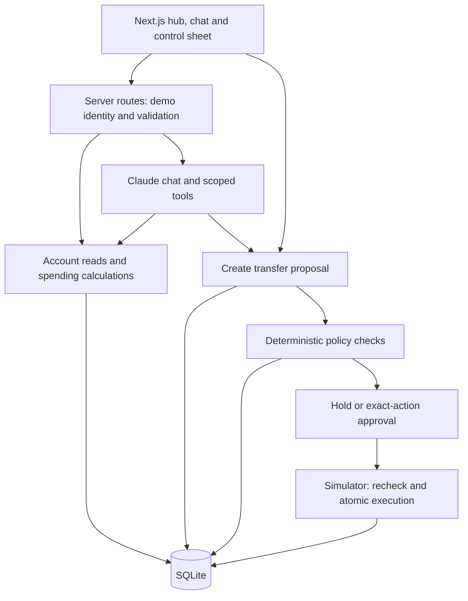

# Onera — Four-Person Hackathon MVP

Planning document, October 10, 2026. No application code is included. This scope supersedes the weekend implementation plan in [ROADMAP.md](ROADMAP.md); that document remains the product roadmap.

## Product promise

**Understand your money in one place, with AI that proposes actions and controls that enforce your decisions.**

Build a finance hub whose signature demonstration is holding a transfer to changed recipient details. Spending insights and chat establish everyday usefulness. The security decision is the moment judges should remember.

## Event assumptions and verified timing

The team has four people and plans to use Claude, Codex, and Gemini for development. Individual strengths have not been specified, so assign the roles below by preference.

HackRU's public website lists hacking starting Saturday, October 10 at noon, submissions due Sunday, October 11 at noon, and judging starting at 1 PM. Use venue announcements if they supersede the website. Set an internal submission target of 11 AM Sunday. The website lists Social Good, Education, and Maverick tracks; specific sponsor prizes remain unconfirmed. [HackRU schedule and tracks](https://www.hackru.org/)

Treat 12–14 focused build hours as an estimate, not a measured amount of remaining time. Schedule work relative to kickoff and protect a rest/demo-preparation buffer. This plan does not verify the pasted claims about pre-event project eligibility or repository submission requirements; follow the actual event rules supplied by organizers.

## Scope lock

| Build | Exact boundary |
|---|---|
| Unified hub | Two seeded users; each has private synthetic accounts and transactions. One primary user appears in the pitch. |
| Spending insight | Deterministic subscription price-increase detection, with evidence transactions; internal transfers excluded from spending. |
| Transfer proposal | Source account, verified recipient record/version, amount, currency, and policy outcome. USD only. |
| Governance | Ownership, recipient allowlist/version, per-transfer and daily limits, available balance, approvals, and pause flag. |
| Simulator | Atomic balance update, one execution receipt per proposal, and audit events. No bank connection. |
| AI assistant | One runtime provider; account read tools, a proposal tool, and structured explanations. No execution or approval tool. |
| Control sheet | Edit limits, pause future execution, view approval/audit evidence. |
| Injection scenario | A labeled synthetic article contains malicious instructions. Show actual tool activity and enforced execution boundary. |

Cut from MVP: Plaid, Alpaca, live transfers/trading, webhooks, external settlement reconciliation, FX, offshore connectivity, mandates, continuous workers, production authentication, autonomous trading, and a separate portfolio/research worker.

A static portfolio summary may be a small hub card if the main transfer flow is already complete. Do not build a trading screen to imply brokerage connectivity. Stock research with a small dated source pack is a stretch feature; it may ship only after the core acceptance checks pass.

## What is real

Real: policy code, ownership checks for demo identities, bound approvals, duplicate-execution protection, calculations, insight detection, model calls when available, and audit records.

Synthetic: people, balances, account history, recipient changes, the injected article, and all money movement. Label them visibly. Demo user switching is not real authentication, so run this locally with synthetic data only.

Recorded: fallback model responses and a backup video. Mark response replay as recorded; a cached explanation must never replay a financial write or supply approval. Policy evaluation still runs against current state.

## Small architecture

One repository, one Next.js application, SQLite, and one local server. No queue service or microservices. Insights run after seed/reset and transaction changes; a small bounded task function provides progress status if needed. Use database transactions and constraints for execution correctness. Model API credentials remain server-side and outside Git.

Organize into `app/`, `lib/db/`, `lib/finance/`, `lib/policy/`, `lib/ai/`, and `fixtures/`. Use one shared transfer schema before parallel feature work. Avoid simultaneous edits to schema, seed files, and shared action types; designate their owners.

## Data and lifecycle

Minimum tables: users, accounts, transactions, recipients, actions, user_controls, and audit_events. Store approval hash/time and simulation receipt on the action row to avoid separate tables. Insights can be derived; a JSON trace field can hold sanitized model/tool activity for this demo.

Amounts use integer cents and explicit USD currency. Track spending with posted transaction data. Link internal-transfer entries so moving money between owned accounts is not counted as expense.

Six states:

`PROPOSED → HELD or AWAITING_APPROVAL → APPROVED → EXECUTED`

`FAILED` covers a failed simulation. A held proposal must be reevaluated before it can await approval. Material edits invalidate approval and return it for evaluation. Holds include machine-readable reasons such as `RECIPIENT_CHANGED`, `LIMIT_EXCEEDED`, `PAUSED`, or `INSUFFICIENT_FUNDS`.

Approval hashes use a canonical server serialization of user, action ID/version, source account, recipient ID/version/destination, amount, and currency. Store the approved hash; recompute it before execution. Clients and models cannot mark an action approved.

Execution transaction: verify owner, state, approval hash, recipient version, current limits/pause/balance; enforce the single-execution condition; debit and credit owned demo accounts when applicable; write the receipt and audit event; commit together. Aggregate daily usage is checked within the same transaction. Repeated execution requests return the existing receipt. A changing destination is never silently treated as verified.

## Team split: two engineering + two business/AI-governance

This replaces the earlier four-engineer split. Roles describe ownership, not seniority. The business/governance pair produces decisions, fixtures, copy, evaluations, and pitch materials while the engineering pair builds the working product.

| Person | Role | Main responsibility | Completion evidence |
|---|---|---|---|
| 1 | Product Engineer — Frontend and AI Experience | Hub, chat integration, transfer review, control UI | A working user journey connected to real server responses |
| 2 | Systems Engineer — Finance and Security | Database, APIs, policy enforcement, approval and simulator | Correct transfer execution plus focused automated checks |
| 3 | Product and Business Lead | Customer problem, scope, positioning, business model and pitch | Clear brief, sourced competitor comparison, demo script and submission draft |
| 4 | AI Governance and Evaluation Lead | Agent permissions, risk scenarios, evidence standards and manual evaluation | Implementable policy matrix, scenario fixtures, completed evaluation results |

### Person 1 — Product Engineer: frontend and AI experience

Own `app/` UI components and `lib/ai/` for the demo. Own the server-side chat route; Person 2 owns the financial routes. Agree shared types first.

Build:

- Finance overview with seeded account balances, transaction list and spending insight.
- Chat panel using one model provider through a server route. Use the team's ready credential; Claude remains the planning default.
- Scoped read and proposal tools calling Person 2's domain functions. Never expose approval/execution as AI tools.
- Transfer preview, held-state explanation, exact-action approval UI and simulated receipt.
- Controls for limits and pause, plus useful loading, failure and recorded-fallback states.

Receive from Person 3: primary user story, priorities, screen wording, pitch requirements. Receive from Person 4: permission rules, hold messages, attack fixtures and evaluation prompts. Receive from Person 2: validated response types and financial endpoints.

Deliver a complete clickable flow; showing an attractive mock screen does not count as implementing approval or policy. Reuse components and keep all credentials server-side.

### Person 2 — Systems Engineer: finance and security

Own `lib/db/`, `lib/finance/`, `lib/policy/`, seed data and shared financial types. Integrate scenario fixtures from Person 4. Own action APIs, calculations and the simulator.

Build:

- SQLite tables for users, accounts, transactions, recipients, actions, user controls and audit events.
- Two synthetic demo identities, server-owned user context and ownership checks.
- Spending calculations excluding internal transfers, and deterministic subscription price-increase detection.
- Proposal creation and six-state lifecycle: proposed, held, awaiting approval, approved, executed, failed.
- Recipient-version checks, amount/daily limits, sufficient funds, pause and exact-action approval hashing.
- Atomic simulated balance updates, single-execution protection, receipts, audit trail and reset flow.
- Focused tests for changed approval details, unauthorized account IDs, repeated/concurrent execution, pause and balance limits.

Provide a small API contract within the first hour so Person 1 can build without waiting. The execution endpoint must check policy independently of the chat and UI. Keep review of core money/control changes with this owner even if assistants generate them.

### Person 3 — Product and Business Lead

Own the story, prioritization, user validation, commercial hypotheses and submission materials. This role works from the start rather than waiting for screenshots.

Cover:

1. **Primary user:** an individual juggling several accounts who wants understandable finances and controlled AI assistance. Pick one concrete persona and three pain points; avoid targeting every consumer and business at once.
2. **User journey:** overview → explain spending → propose transfer → understand hold → approve a valid action → see receipt.
3. **Validation:** if available, speak with three to five attendees about how they check recipients, manage multiple accounts and feel about AI permissions. Record actual answers and sample size; do not invent validation.
4. **Competition:** compare three to five actual products across account visibility, research, transfer capability, approval controls and agent permissions. Verify claims from official product pages and attach dates/links. Do not claim novelty from an incomplete comparison.
5. **Business model:** articulate a testable subscription hypothesis for consumers and a possible later B2B path. Pricing, acquisition cost, willingness to pay and market size remain hypotheses unless supported. Paid transfers or brokerage revenue are future partner-dependent options, not implemented revenue.
6. **Pitch:** problem, target user, working solution, security demonstration, differentiation, business hypothesis and next steps.
7. **Submission:** prepare the description, screenshots, credits/tools used, limitations, repository/demo links when available, and backup recording. Check actual organizer requirements before submission.

Early deliverables: a one-page brief and prioritized user flow. Later deliverables: a compact competitor table, three-minute script, three to five concise slides if useful, and submission draft.

Scope authority: prioritize or cut features in consultation with engineering. Do not add live banking, trading or offshore integrations to improve the pitch. Ask Person 4 to review security claims.

### Person 4 — AI Governance and Evaluation Lead

Own the rules the engineers enforce, the scenarios used to prove them, and the accuracy of the product's AI/security claims. This role does not make legal determinations or replace engineering enforcement.

Cover:

1. **Permission matrix:** which data each AI tool can read, which actions it can propose, and who can approve/execute. Model access excludes credentials, full bank numbers and other users' records.
2. **Policy matrix:** trigger → outcome → reason → recovery path. Specify changed recipient, unverified recipient, exceeded limit, insufficient funds, pause, missing approval and modified approved action.
3. **Risk register:** wrong-user data access, unsafe tool requests, untrusted article instructions, fabricated explanations, double execution and stale/mismatched approvals. Tie each risk to an actual control and check.
4. **AI answer standards:** claims cite the supplied transaction/source evidence, money totals come from calculation tools, missing data is explicit, and synthetic/recorded content is labeled.
5. **Fixtures:** valid transfer, changed-recipient transfer, over-limit transfer, subscription increase and synthetic injected article. Each has input, expected outcome and explanation. Engineers load fixtures; do not implement a second policy engine in parallel.
6. **Evaluation:** run normal and adversarial prompts against the actual app; record expected outcome, actual outcome, evidence and unresolved failures. Distinguish a model refusing an instruction from a server blocking execution.
7. **Transparency:** review screen labels and pitch claims with Person 3. A handful of tests does not establish universal fraud detection, prompt-injection immunity or regulatory compliance.

Early deliverables: permission matrix and initial five scenarios before the engineers build most controls. Later deliverables: completed evaluation sheet and approved claim wording. Keep this work in short tables that map directly to code and demo behavior.

### Shared rules for collaboration

- Use Claude, Codex and Gemini for development as desired; one model provider in the app initially.
- Person 2 owns schema and financial contracts. Person 1 owns UI and chat implementation. Shared files change through the designated owner.
- Person 3 defines the problem and priorities; Person 4 defines risk requirements and evidence; engineers own technical implementation.
- Never let the model approve its own proposal. Governance decisions are enforced in server code.
- Business and governance teammates test fresh builds continuously; engineers fix behavior and own automated checks.
- Feature scope stays locked to the simulator MVP. Review every new idea against remaining time and the core demo.

## Build sequence and cut rules

| Focused elapsed time | Required result |
|---|---|
| 0–1 hour | App runs locally; shared types agreed; SQLite seeded; secrets ignored; mock screen available. |
| 1–4 hours | Allowed and held transfer scenarios work end-to-end with server checks, approval and audit. UI/AI work can proceed against the stable contract. |
| 4–7 hours | Hub and control sheet connected; ownership, duplicate-submit and changed-approval checks pass. |
| 7–10 hours | Chat uses actual tools; subscription insight links evidence; injection scenario produces an honest trace. |
| 10–12 hours | Run complete demo, fix broken states, prepare screenshots and fallback responses. |
| 12–14 hours | Record backup, polish pitch, confirm launch/reset instructions and submit. No new integrations. |

If the transfer path is incomplete at hour 4, stop research/portfolio work. If model access is unreliable at hour 7, finish the deterministic transfer demo and explicitly label recorded AI examples. Freeze features by 8 AM Sunday or earlier if needed; aim to submit by 11 AM, ahead of the published noon deadline.

## Essential checks

1. Alice cannot read or act on Bob's account by changing IDs in API/tool requests. Demo identity comes from server session context, not model input; the deliberately available local user switch is documented as a demo mechanism.
2. A verified own-account transfer executes once, updates both balances consistently, and produces a receipt.
3. An unverified/changed recipient is held with the specific reason and cannot execute by direct API call.
4. Changing amount or recipient after approval invalidates approval.
5. Repeated or concurrent submissions cannot execute twice or exceed aggregate limits.
6. Pause prevents new execution, including proposals approved before the pause.
7. Internal transfers do not inflate spending and the subscription increase cites its transaction evidence.
8. Injected article text cannot obtain execution privileges. Report what the model actually did; if it ignores the injection, say so. Separately exercise unauthorized execution directly to prove the server boundary.

These checks apply to the simulator. They do not establish production authentication, banking readiness, comprehensive prompt-injection prevention, or real-world fraud-detection accuracy.

## Main three-minute demonstration

- **0:00–0:25:** “These are synthetic accounts. The AI integration and security checks are working.” Show one user's financial overview.
- **0:25–0:55:** Ask about spending. Show the detected subscription increase and its underlying records.
- **0:55–1:55:** Request a transfer. Destination details have changed. Highlight the difference, show the hold, and show that clicking or calling execute cannot bypass it.
- **1:55–2:25:** Complete a valid transfer after exact-action approval. Show simulated balances and the receipt; click again to demonstrate no duplicate execution.
- **2:25–3:00:** Show the injected article or the changed-approval check, then pause controls and audit history. Choose whichever scenario is most reliable in rehearsal.

Final line: **“The AI helps you decide. Your permissions determine what it can do.”**

Describe multi-bank connectivity, research/trading expansion, and country-specific international integrations as the roadmap. Do not claim the entire finance platform is implemented. Keep the pitch about a useful financial assistant with verifiable action controls.
