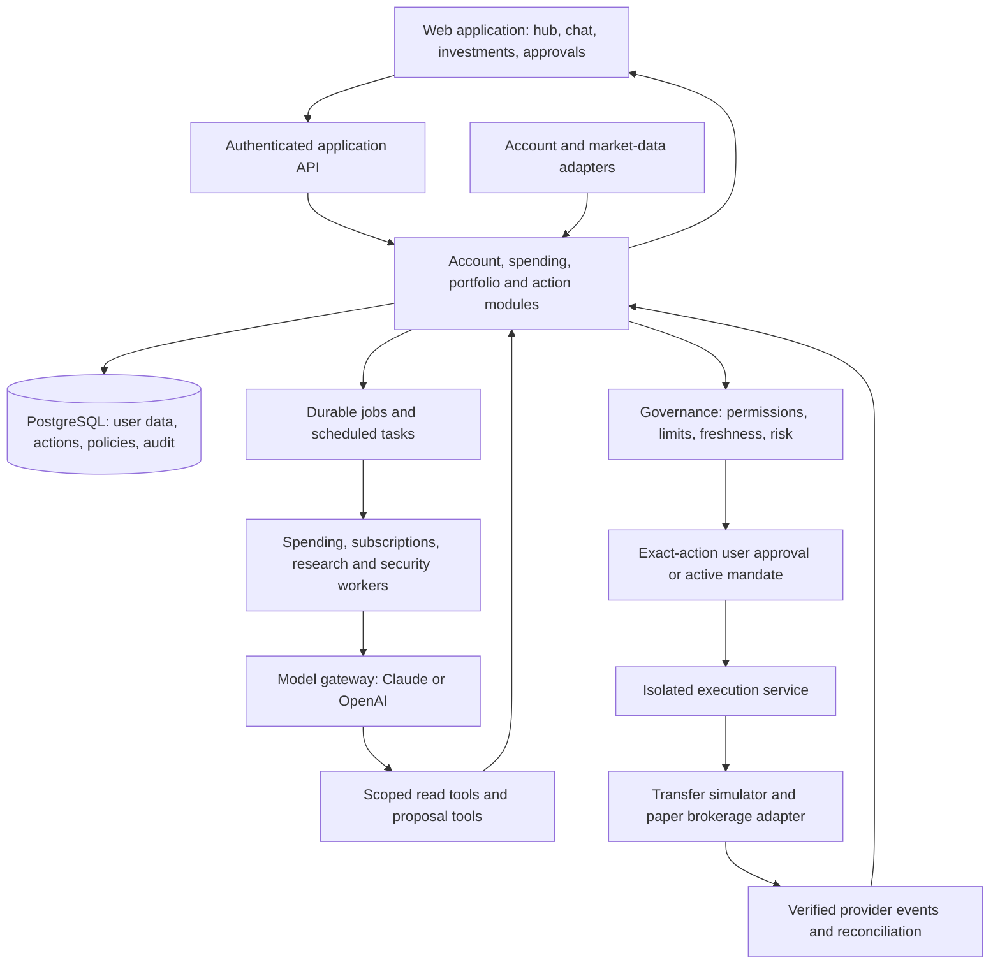

# Finance Hub — Hackathon Architecture

**Scope update:** This document is the longer-term product roadmap. For the four-person hackathon build, use [Onera MVP Scope](MVP_SCOPE.md). That plan supersedes the implementation scope, stack, build order, and acceptance criteria below for the event.

Prepared October 10, 2026. Working product name: **Onera**. Name availability has not been checked.

## 1. Product and pitch

**One place to understand your money, research investments, and control what AI can do with it.**

Onera brings connected account information, spending, subscriptions, investments, research, and transfer previews into one application. Specialized background workers find useful changes and prepare suggestions. A governance service checks every proposed financial action against permissions and limits before an execution service can act.

The signature demo is a suspicious transfer being held while a legitimate transfer proceeds through approval. The account hub and investment research explain why someone would use the app every day; governance explains why they could trust its automation.

Initial audience: individuals managing several accounts and an investment portfolio. Business treasury, professional advisers, and shared household access are later extensions.

## 2. What is real and what is simulated

| Component | Hackathon implementation | Boundary to show in the app |
|---|---|---|
| Accounts and spending | Synthetic account history; optional Plaid Sandbox connection | Demo accounts; last sync timestamp |
| Bank transfers | Local transfer simulator with asynchronous status events | Simulated transfer; no money moved |
| International accounts | Synthetic USD and foreign-currency account, with a timestamped demo FX rate | Demo FX; account visibility does not imply transfer support |
| Stocks and ETFs | Real market-data API where credentials and entitlements permit | Source, market timestamp, and whether delayed |
| Research chat | Actual model calls using retrieved sources and scoped account summaries | Citations, data dates, uncertainty |
| Trading | Broker paper-trading API if configured; deterministic simulator otherwise | Paper order or simulated order, visibly distinguished |
| Monitoring | Real event jobs running against demo transactions and positions | Evidence and last successful run |
| Governance | Real application rules, consent checks, approval records, and audit events | Reason for allow, hold, or reject |

Ship a complete seeded demo first. Provider integrations enhance it without becoming prerequisites for a successful presentation. Never label a local mock as a provider connection. Do not use a shared real trading account to represent multiple customers.

## 3. Product surfaces

1. **Home:** net worth, cash by account, recent activity, bills due, and a short “Needs attention” list. Each metric exposes its source and timestamp.
2. **Accounts:** balances, institution, currency, connection health, and capabilities such as view, transfer source, or trading. Users can disconnect accounts.
3. **Invest:** positions, stock/ETF watchlist, quote charts, cited research, and a paper order ticket. Distinguish holdings imported from another broker from positions that this app can trade.
4. **Activity:** transactions, transfers, orders, recurring spending, and agent findings, filterable by account.
5. **Control:** agent permissions, approval limits, automation mandates, and a pause button. This can be a settings sheet rather than another large dashboard.

Keep one persistent “Ask Onera” entry point. Chat returns financial explanations and structured action previews. Final approval happens on a transaction card with explicit amounts and destinations.

## 4. Architecture



The arrows describe logical modules, not a fleet of microservices. Start with one web application, one backend codebase, and a worker process. Keep execution credentials and privileges separate from AI workers even when deployed from the same repository.

Read requests can return directly from core modules. Every financial write must pass the policy, authorization, and execution path. A model cannot invoke provider execution endpoints directly.

## 5. Suggested stack

These are implementation recommendations, not requirements imposed by the providers.

| Layer | Base choice | Purpose |
|---|---|---|
| Frontend | Next.js, React, TypeScript, Tailwind | Responsive hub and approval flows |
| API | TypeScript with schema validation | Typed tools and financial action requests |
| Storage | PostgreSQL | Account snapshots, policies, action states, jobs, audit records |
| Background work | PostgreSQL-backed durable queue and scheduler | Retryable sync, monitoring, and research tasks |
| AI | Server-side provider gateway | Select Claude or OpenAI by task, with budgets and timeouts |
| Account data | Mock adapter plus optional Plaid Sandbox adapter | Consistent account and transaction interface |
| Markets/trading | Market-data adapter plus Alpaca paper adapter | Quotes, research context, and paper orders |
| Updates | Server-sent events or bounded polling | Agent progress and action status |
| Identity | Managed authentication; demo identities in isolated demo mode | User sessions and approval identity |

Do not add a vector database initially. Structured financial records belong in SQL. Start research retrieval with a small source fetcher and document store; add semantic search only when the corpus warrants it. Routing tasks between models does not itself make answers reliable, and voting among models is not a security control.

## 6. Core data model

All private tables carry a user or tenant identifier. Enforce ownership in API queries, jobs, tools, and database policies where available. The model must never choose which user it acts as.

| Entity | Essential fields |
|---|---|
| User | ID, home currency, authentication identity |
| Connection | owner, provider, external reference, consent scopes, token reference, health |
| Account | connection, external ID, type, currency, capabilities |
| BalanceSnapshot | account, ledger/available balance where provided, currency, observed time |
| Transaction | account, provider ID, amount, currency, pending/posted status, linked pending ID |
| Position | account, instrument ID, quantity, cost basis when available, observed time |
| Quote / FXRate | instrument or pair, source, value, observed time, freshness class |
| RecurringPattern | merchant, cadence, estimated next date, evidence transactions, uncertainty |
| Insight | type, evidence IDs, explanation, status, expiry |
| ResearchDocument / Claim | source URL, fetched/published time, content reference, supporting passage |
| AgentRun | task, user, trigger, input versions, model/prompt version, tool calls, cost, outcome |
| ActionProposal | transfer/order type, exact parameters, evidence, status, version, expiry |
| Policy / Mandate | owner, action scope, limits, allowed recipients/assets, duration, revoked time |
| Approval | approver, proposal version/hash, approved time, expiry, authentication context |
| ExecutionAttempt | action ID, idempotency key, provider reference, state, error, reconciled time |
| AuditEvent | actor, action, policy decision, timestamp, relevant IDs |

Use decimal arithmetic or currency-aware integer minor units for money, never binary floating-point calculations. Share quantities and FX rates need appropriate decimal precision. Store original currency; convert only with a dated FX rate. Exclude matched internal transfers from spending totals and avoid counting an imported brokerage account twice when it is also directly connected.

For a simulator, maintain a balanced journal and reservations to demonstrate insufficient-funds handling. A production ledger would require a more detailed design; aggregated account snapshots are not custody records or proof of spendable funds.

## 7. Background agents

“Asynchronous agents” means durable tasks triggered by data changes or schedules. Most monitoring should use repeatable calculations first, with AI explaining findings. Avoid continuously running chat loops.

| Worker | Trigger | Output | Permission |
|---|---|---|---|
| Spending | Transaction sync completes | Category changes, unusual spending, cash-flow summary | Read assigned transactions; write insights |
| Subscription | New posted activity or daily schedule | Probable recurring charges, price increases | Read spending; propose reminders |
| Research | User asks about a ticker or refreshes watchlist | Cited brief, competing evidence, risks | Read approved research sources and scoped portfolio context |
| Portfolio | Position/quote update | Exposure, concentration, change explanations | Read positions; propose paper orders |
| Security | Transfer/order proposal | Account changes, unusual destination, policy evidence | Read proposal and relevant history; request a hold |

Security analysis supplements hard controls. A low AI risk assessment cannot override an unverified destination, missing approval, or exceeded mandate. Subscription detection does not automatically cancel subscriptions; cancellation requires a separately implemented provider workflow and authorization.

Each job has a deduplication key, maximum runtime, bounded retries, and a dead-letter state. Record partial failures. Suppress repeated alerts unless evidence materially changes. A spending job failing must not prevent a transfer risk check from running.

## 8. Research chatbot

The chat service retrieves scoped records and dated market information, fetches selected sources, and returns a structured answer containing claims, supporting URLs/passages, calculations, and limitations. Portfolio totals and percentages come from calculation tools rather than model arithmetic.

Example questions:

- “What changed in my spending this month?”
- “Which subscriptions increased in price?”
- “Compare these two ETFs by expenses and sector exposure.”
- “What risks does the latest company filing identify?”
- “Preview buying $100 of this ETF in my paper account.”

Separate company facts, analyst interpretation, user portfolio exposure, and trade proposals. Show source dates and delayed quotes. External articles and filings are untrusted content: they cannot grant permissions, change policy, or direct tool execution. Return an explicit unavailable-data answer when retrieval fails.

The model gateway receives minimal relevant data. It never receives bank tokens, full account numbers, authentication secrets, or unrestricted customer history. Provider switching is configuration, not an excuse to send the same sensitive data to several providers by default.

## 9. Governance and execution

Governance is a working control service, not another chatbot.

1. **Data scope:** Which accounts and records may this worker read?
2. **Tool scope:** May it explain, create a proposal, or request execution?
3. **Action limits:** Allowed recipients/assets, per-action and aggregate budgets, minimum cash reserve, and allowed order types.
4. **Freshness:** Are the balance, quote, recipient verification, and policy current enough?
5. **Authorization:** Does the exact action have unexpired user approval or a valid automation mandate?
6. **Operations:** Is the account connected, the provider healthy, and automation enabled?

An approval binds to a specific action version: source, destination, amount, currency, fees/FX terms when applicable, or symbol, side, quantity/notional and order limits. Changing any material field invalidates approval. Recheck policy immediately before submission and reserve budget atomically so simultaneous jobs cannot exceed limits.

Suggested action lifecycle:

`DRAFT → CHECKING → AWAITING_APPROVAL → AUTHORIZED → SUBMITTING → PENDING → COMPLETED`

Additional outcomes: `HELD`, `REJECTED`, `EXPIRED`, `CANCELED`, `FAILED`, and `UNKNOWN`. A held action resumes only after the missing condition is resolved and checks run again. A timeout after submission becomes unknown until reconciliation confirms what happened; do not blindly retry a possibly accepted payment. Transfers may later be returned, and orders may be partially filled: track these separately from initial acceptance.

Use provider-supported idempotency keys, unique action constraints, and reconciliation. Webhook delivery may repeat or arrive out of order. Verify events before ingesting them, persist them quickly, then process in workers. A global pause stops new submissions; it does not undo already submitted actions.

## 10. Levels of autonomy

| Level | Behavior | Hackathon scope |
|---|---|---|
| Observe | Monitor and explain | Enabled |
| Suggest | Prepare a transfer or paper order | Enabled |
| Approve each action | User reviews exact details | Default execution flow |
| Bounded automation | Execute within an explicit, revocable mandate | Optional paper-only demonstration |

Example paper mandate: permit purchases of one selected ETF, maximum $25 per order and $100 total per day, preserve a specified cash reserve, expire after the demo. These are illustrative product controls, not an investment recommendation. Bind mandates to the paper environment and prohibit leverage/options in this prototype.

Allow autonomous monitoring from day one. Add autonomous financial execution only behind enforceable mandates. A security worker cannot approve its own proposal.

## 11. Integrations and real-product path

- **Account aggregation:** Plaid can supply supported account data. Its Investments product provides holdings and transaction information in the US and Canada; it does not grant trading access to every imported brokerage. [Plaid Investments](https://plaid.com/docs/investments/)
- **Sync:** Fetch incremental changes, update normalized records, and enqueue downstream jobs. Use verified webhook events plus periodic reconciliation. [Plaid sync guide](https://plaid.com/docs/transactions/sync-migration/), [webhook handling](https://plaid.com/docs/api/webhooks/)
- **Money movement:** Select a payment partner specifically supporting the intended consumer own-account or third-party transfer flow. Plaid explicitly directs unsupported money-transfer-app and non-US cases toward Auth with a separate processor. Do not assume Plaid Transfer fits this product. [Plaid Transfer overview](https://plaid.com/docs/transfer/)
- **Trading:** A paper API is suitable for the prototype. Supporting customer brokerage accounts requires a supported brokerage integration and the corresponding onboarding model. Alpaca documents separate Broker API capabilities for end-user accounts. [Paper trading](https://docs.alpaca.markets/us/docs/paper-trading), [Broker API](https://docs.alpaca.markets/us/v1.1/docs/about-broker-api)
- **International accounts:** Implement country/provider capability metadata now. Begin with imported or synthetic account visibility. Real international transfers additionally need supported corridors, recipient checks, FX quotes, fees, expiry, and settlement tracking. Do not promise worldwide coverage.
- **Real deployment:** Partner approval, identity checks, fraud operations, market-data rights, and assessment of the actual payment/investment business model are separate launch workstreams. Automated personalized advice can raise investment-adviser obligations; a research label or disclaimer does not settle that question. [SEC robo-adviser guidance](https://www.sec.gov/investment/im-guidance-2017-02.pdf)

## 12. Initial API and repository boundaries

Representative API surface:

```text
GET  /accounts                       Scoped account overview
GET  /transactions                   Normalized spending activity
GET  /portfolio                      Positions and dated valuation
POST /chat                           Stream research/explanations
GET  /insights                       Findings and evidence
POST /actions                        Create transfer/order proposal
POST /actions/:id/evaluate            Apply current policy
POST /actions/:id/approve             Approve exact action version
POST /actions/:id/execute             Queue checked execution
GET  /actions/:id                     Reconciled status
POST /mandates                       Create bounded paper mandate
POST /mandates/:id/revoke             Revoke future authority
POST /automation/pause               Stop new automated submissions
POST /webhooks/:provider              Verify and durably ingest events
```

Execution routes are authenticated, ownership-checked, and enforce policy even if called without the UI. Workers use service identities with explicit capabilities. Environment selection is server-controlled; client requests cannot switch from paper to live.

```text
apps/web/                  User interface and application API
apps/worker/               Durable task handlers
packages/domain/           Accounts, insights, proposals and state transitions
packages/agents/           Scoped tools, prompts and structured outputs
packages/governance/       Policies, mandates and approvals
packages/execution/        Privileged action executor and reconciliation
packages/providers/        Mock, Plaid, market-data and brokerage adapters
packages/db/               Schema and migrations
fixtures/                  Synthetic users, accounts and attack scenarios
```

## 13. Build order and acceptance

**First: complete demo spine.** Seed two bank accounts, a paper portfolio, and transaction history. Implement the hub, action proposals, policy evaluation, approval, simulator, and audit record. This produces a demonstrable product even without external credentials.

**Second: connect intelligence.** Add actual model-backed chat, source retrieval, market data, and two monitoring workers: subscriptions and transfer security. Use deterministic calculations and findings that link back to their evidence.

**Third: integrate and polish.** Add paper brokerage and optional bank sandbox, connection-health states, mobile layout, loading/error states, and an easily resettable demonstration scenario. Add the bounded paper mandate only if the main flows are complete.

Acceptance criteria:

- Internal transfers do not inflate spending; repeated sync events do not duplicate transactions.
- Each private API, tool and background job rejects another user's account IDs.
- Altering a destination or amount after approval prevents execution.
- Concurrent execution attempts create at most one provider submission and respect shared limits.
- Duplicate and out-of-order events do not regress final state.
- Submission timeout reconciles rather than double-paying.
- Missing/stale data creates a clear hold or unavailable answer.
- A malicious instruction inside research content cannot bypass permissions.
- Revoking a mandate or pausing automation prevents new submissions.
- Partial fills and failed/returned transfers appear honestly.
- Demo, sandbox, paper, delayed-data and simulated FX labels remain visible.

## 14. Three-minute pitch demo

1. **0:00–0:30:** Explain the problem: accounts are fragmented; AI should simplify decisions without quietly gaining control over money. Show the unified hub.
2. **0:30–1:00:** Ask what changed this month. A worker identifies a subscription price increase and shows the transactions behind it.
3. **1:00–1:40:** Ask about an ETF. Show dated sources, portfolio context, and a paper-order preview; approve it and display the real paper status or clearly labeled simulator result.
4. **1:40–2:30:** Attempt a transfer to changed account details. The security finding explains the difference; governance holds the action until the recipient is verified. Show a valid own-account transfer proceeding through approval.
5. **2:30–3:00:** Open Control. Show account-scoped agent permissions, daily paper limits, the audit trail, and pause automation.

Pitch line: **“Onera connects your financial picture and gives AI useful work to do—with explicit limits on every action.”**

Architecture is proposed; no application or integrations have been implemented by this document.
