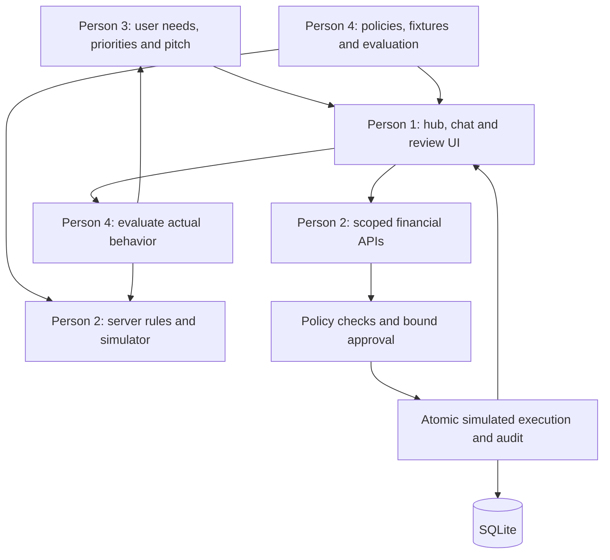

# ClearFi — Team Roles and Delivery Plan

Updated October 10, 2026. Four-person split requested by the team: **two engineering/build roles and two business/AI-governance roles**. This is a planning handoff, not evidence that the product has been built.

Build target: a local finance hub using synthetic accounts, real model chat where available, and a transfer simulator with working server controls. Live banking, brokerage, FX, offshore integration and autonomous trading remain outside the MVP.

## Team split: two engineering + two business/AI-governance

This replaces the earlier four-engineer split. Roles describe ownership, not seniority. The business/governance pair produces decisions, fixtures, copy, evaluations, and pitch materials while the engineering pair builds the working product.

| Person | Role | Main responsibility | Completion evidence |
|---|---|---|---|
| 1 | Product Engineer — Frontend and AI Experience | Hub, chat integration, transfer review, control UI | A working user journey connected to real server responses |
| 2 | Systems Engineer — Finance and Security | Database, APIs, policy enforcement, approval and simulator | Correct transfer execution plus focused automated checks |
| 3 | Product and Business Lead | Customer problem, scope, positioning, business model and pitch | Clear brief, sourced competitor comparison, demo script and submission draft |
| 4 | AI Governance and Evaluation Lead | Agent permissions, risk scenarios, evidence standards and manual evaluation | Implementable policy matrix, scenario fixtures, completed evaluation results |

### Person 1 — Product Engineer: frontend and AI experience

Own `app/` UI components and `lib/ai/` for the demo. Own the server-side chat route; Person 2 owns the financial routes. Agree shared types first.

Build:

- Finance overview with seeded account balances, transaction list and spending insight.
- Chat panel using one model provider through a server route. Use the team's ready credential; Claude remains the planning default.
- Scoped read and proposal tools calling Person 2's domain functions. Never expose approval/execution as AI tools.
- Transfer preview, held-state explanation, exact-action approval UI and simulated receipt.
- Controls for limits and pause, plus useful loading, failure and recorded-fallback states.

Receive from Person 3: primary user story, priorities, screen wording, pitch requirements. Receive from Person 4: permission rules, hold messages, attack fixtures and evaluation prompts. Receive from Person 2: validated response types and financial endpoints.

Deliver a complete clickable flow; showing an attractive mock screen does not count as implementing approval or policy. Reuse components and keep all credentials server-side.

### Person 2 — Systems Engineer: finance and security

Own `lib/db/`, `lib/finance/`, `lib/policy/`, seed data and shared financial types. Integrate scenario fixtures from Person 4. Own action APIs, calculations and the simulator.

Build:

- SQLite tables for users, accounts, transactions, recipients, actions, user controls and audit events.
- Two synthetic demo identities, server-owned user context and ownership checks.
- Spending calculations excluding internal transfers, and deterministic subscription price-increase detection.
- Proposal creation and six-state lifecycle: proposed, held, awaiting approval, approved, executed, failed.
- Recipient-version checks, amount/daily limits, sufficient funds, pause and exact-action approval hashing.
- Atomic simulated balance updates, single-execution protection, receipts, audit trail and reset flow.
- Focused tests for changed approval details, unauthorized account IDs, repeated/concurrent execution, pause and balance limits.

Provide a small API contract within the first hour so Person 1 can build without waiting. The execution endpoint must check policy independently of the chat and UI. Keep review of core money/control changes with this owner even if assistants generate them.

### Person 3 — Product and Business Lead

Own the story, prioritization, user validation, commercial hypotheses and submission materials. This role works from the start rather than waiting for screenshots.

Cover:

1. **Primary user:** an individual juggling several accounts who wants understandable finances and controlled AI assistance. Pick one concrete persona and three pain points; avoid targeting every consumer and business at once.
2. **User journey:** overview → explain spending → propose transfer → understand hold → approve a valid action → see receipt.
3. **Validation:** if available, speak with three to five attendees about how they check recipients, manage multiple accounts and feel about AI permissions. Record actual answers and sample size; do not invent validation.
4. **Competition:** compare three to five actual products across account visibility, research, transfer capability, approval controls and agent permissions. Verify claims from official product pages and attach dates/links. Do not claim novelty from an incomplete comparison.
5. **Business model:** articulate a testable subscription hypothesis for consumers and a possible later B2B path. Pricing, acquisition cost, willingness to pay and market size remain hypotheses unless supported. Paid transfers or brokerage revenue are future partner-dependent options, not implemented revenue.
6. **Pitch:** problem, target user, working solution, security demonstration, differentiation, business hypothesis and next steps.
7. **Submission:** prepare the description, screenshots, credits/tools used, limitations, repository/demo links when available, and backup recording. Check actual organizer requirements before submission.

Early deliverables: a one-page brief and prioritized user flow. Later deliverables: a compact competitor table, three-minute script, three to five concise slides if useful, and submission draft.

Scope authority: prioritize or cut features in consultation with engineering. Do not add live banking, trading or offshore integrations to improve the pitch. Ask Person 4 to review security claims.

### Person 4 — AI Governance and Evaluation Lead

Own the rules the engineers enforce, the scenarios used to prove them, and the accuracy of the product's AI/security claims. This role does not make legal determinations or replace engineering enforcement.

Cover:

1. **Permission matrix:** which data each AI tool can read, which actions it can propose, and who can approve/execute. Model access excludes credentials, full bank numbers and other users' records.
2. **Policy matrix:** trigger → outcome → reason → recovery path. Specify changed recipient, unverified recipient, exceeded limit, insufficient funds, pause, missing approval and modified approved action.
3. **Risk register:** wrong-user data access, unsafe tool requests, untrusted article instructions, fabricated explanations, double execution and stale/mismatched approvals. Tie each risk to an actual control and check.
4. **AI answer standards:** claims cite the supplied transaction/source evidence, money totals come from calculation tools, missing data is explicit, and synthetic/recorded content is labeled.
5. **Fixtures:** valid transfer, changed-recipient transfer, over-limit transfer, subscription increase and synthetic injected article. Each has input, expected outcome and explanation. Engineers load fixtures; do not implement a second policy engine in parallel.
6. **Evaluation:** run normal and adversarial prompts against the actual app; record expected outcome, actual outcome, evidence and unresolved failures. Distinguish a model refusing an instruction from a server blocking execution.
7. **Transparency:** review screen labels and pitch claims with Person 3. A handful of tests does not establish universal fraud detection, prompt-injection immunity or regulatory compliance.

Early deliverables: permission matrix and initial five scenarios before the engineers build most controls. Later deliverables: completed evaluation sheet and approved claim wording. Keep this work in short tables that map directly to code and demo behavior.

### Shared rules for collaboration

- Use Claude, Codex and Gemini for development as desired; one model provider in the app initially.
- Person 2 owns schema and financial contracts. Person 1 owns UI and chat implementation. Shared files change through the designated owner.
- Person 3 defines the problem and priorities; Person 4 defines risk requirements and evidence; engineers own technical implementation.
- Never let the model approve its own proposal. Governance decisions are enforced in server code.
- Business and governance teammates test fresh builds continuously; engineers fix behavior and own automated checks.
- Feature scope stays locked to the simulator MVP. Review every new idea against remaining time and the core demo.

## Architecture ownership and handoffs

The product still runs as one local Next.js application with SQLite. These boxes describe team ownership; they do not introduce services, infrastructure or extra build scope.

| Handoff | Artifact | Needed by |
|---|---|---|
| Product → engineering | Primary persona, core user story, must-have screen flow | First hour |
| Governance → systems | Permission/policy matrix, scenario inputs and expected outcomes | First hour |
| Systems → frontend | Shared types, stable function/API signatures, seed examples | First hour |
| Engineering → governance | Running valid/held transfer path | Around focused hour 4 |
| Governance → engineering | Reproducible failures, severity, expected behavior | Continuously after first build |
| Engineering/governance → business | Verified feature list and demo evidence | Before script/recording freeze |
| Business → whole team | Final script, submission materials and rehearsal order | Final build block |

## Time-boxed work plan

Hours below are focused build time from kickoff, not time remaining. Preserve rest and leave a submission buffer.

| Block | Engineer 1 | Engineer 2 | Business lead | Governance lead |
|---|---|---|---|---|
| 0–1 hour | UI shell and chat contract | Schema, seed and action contract | Persona, pitch angle, scope list | Permissions, policy matrix, scenarios |
| 1–4 hours | Hub, transfer preview, hold/approve screens | Full transfer path, simulator, core tests | User feedback, competitor sources, copy | Prepare fixtures; test first API/build |
| 4–7 hours | Chat tools and control UI | Insights, audit/reset, integration fixes | Business hypothesis, draft script/submission | Run scenario suite, log failures |
| 7–10 hours | Error states, fallback, visual clarity | Correctness fixes and complete checks | Rehearse with actual build; gather screenshots | Attack/approval tests; review claims |
| Final 2–4 hours | Freeze features; fix demo blockers | Confirm launch, reset and consistency | Record backup, finalize and submit | Re-run critical cases; verify honest labels |

With only two engineers, AI chat comes after the valid/held transfer path. If time runs short, cut stock research, portfolio cards and the optional injection showcase. Preserve one working model integration if feasible, but a recorded fallback must be labeled. Do not cut approval checks to save a visual feature.

## Governance policy examples to hand to engineering

| Trigger | Outcome | User explanation | Recovery |
|---|---|---|---|
| Verified recipient, valid approval, limits and balance pass | Execute simulated action once | Transfer completed in demo mode | View receipt |
| Recipient details changed | Hold | Destination differs from the verified record | Use a verified recipient; any demo verification/reset is explicit |
| Amount above configured limit | Hold | Amount exceeds your transfer limit | Reduce amount or change limit deliberately; re-evaluate |
| Approved amount/destination edited | Reject execution; re-evaluate proposal | Approval no longer matches this transfer | Review and approve new exact details |
| Automation paused | Hold execution | Transfers are paused | User resumes and checks run again |
| Model asks to execute a payment | Tool unavailable; financial endpoint still enforces approval | AI can prepare transfers; user approval is required | Open the review flow |

These are application-design rules for a synthetic demo, not a claim of legal compliance or a production fraud model.

## Pitch ownership

Person 3 leads the narrative and submission. Person 1 drives the live interface. Person 2 explains the action boundary and handles technical questions. Person 4 explains which rules were tested and what the evidence shows. Not everyone needs to speak during the three-minute pitch.

Three-minute structure: 25 seconds for the fragmented-finance problem and synthetic-data disclosure; 30 seconds for hub/insight usefulness; 60 seconds for the held transfer; 30 seconds for a valid approved transfer and duplicate protection; 35 seconds for controls, differentiation and roadmap.

Prepare concise answers to: Who needs this? What is actually built? Why use AI? Why can't a prompt bypass approval? How will you make money? What happens when the model fails? What remains before real banking/trading? Which claims are supported by tests?

## Finish checklist

- Engineering: resettable local app, actual valid/held transfer behavior, passing core checks, no client-side secrets.
- Business: concise product brief, evidence-linked comparison, clearly labeled commercial hypotheses, rehearsed pitch and complete submission draft.
- Governance: permission/policy matrix, scenario fixtures, recorded actual results and accurate security claims.
- Whole team: one feature list separating real code, synthetic financial data, recorded fallback and future integrations; one backup recording.
