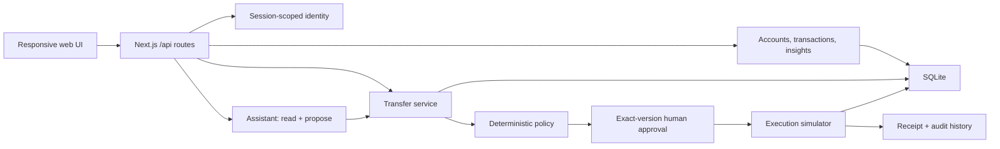

# ClearFi — Azure design handoff
October 10, 2026 · Web first · Design exploration

## Start here
Open `index.html` for a local visual gallery. The three web concepts use the user's nine references and exact supplied palette. They supersede the older zinc/teal design study as the latest exploration, and the user selected **01 Obsidian Flow** for implementation. See [the implemented app and QA guide](../../UI-IMPLEMENTATION.md).

Recommendation: select **01 Obsidian Flow** as the overview direction, then extend its visual system using the focused review hierarchy in **03 Midnight Canvas**. **02 Paper Horizon** is a light alternative, not yet a validated light theme of the same component system.

This folder records the earlier generated raster design exploration. Its original scope did not change application code or deployment. The selected direction has since been implemented in the application; use the implementation guide above for current behavior and QA. The exploration's motion notes and mobile blueprint below describe design intent.

## Deliverables
| File | Purpose |
| --- | --- |
| mockups/01-obsidian-flow.png | Dark overview; azure balance surface, quiet account rows, contextual attention |
| mockups/02-paper-horizon.png | Light overview; open ledger with a contextual transfer review sheet |
| mockups/03-midnight-canvas.png | Focused assistant workspace with a persistent transfer review |
| brand/logo-exploration.png | Transparent raster exploration: two rounded bands forming an open C |
| TOKENS.json | Exact palette and proposed spacing, type, material and motion tokens |
| PROMPTS.json | Generation prompts and reference mapping |
| references/ | All nine supplied images, retained as inspiration |
| architecture/ | API and backend-plan snapshots; refresh against the repo before building |

The logo is provisional while the user supplies further logo references. Refine its silhouette at 16, 24 and 32 pixels and create a proper vector master after selection. It is not a trademark-cleared identity. Reference brands and card imagery are not production assets.

## Design intent
Make the next useful action obvious. Use one dominant surface per screen, open rows for supporting information, and gentle depth for navigation and temporary review surfaces. Avoid decorating the app with unrelated finance charts, artificial growth percentages, or a grid of feature cards.

Use paper white and light azure for text on dark surfaces. Use onyx text and dark azure actions on white. The large balance gradient is decorative; account data and decisions must remain legible when blur and transparency are disabled. Keep gradient highlights away from body copy. Treat amber as a small semantic hold indicator, paired with text; it is not an added brand color.

Typography: system UI stack; 16px body, 14px secondary, 12px only for incidental metadata; 28–36px page heading; 48–64px desktop balance; tabular numerals. Use 1.45–1.55 line height for explanations. The oversized heading in concept 03 should shrink in implementation to prioritize working conversation space.

## Source architecture
Verified repository: `/Users/taruntt/Documents/GitHub/RuHackathon`.

Current stack: Next.js 16, React 19, Tailwind 4, TypeScript, better-sqlite3, Zod, Anthropic SDK. Existing UI components are custom. Motion, shadcn/ui and Lucide are recommendations, not installed dependencies.

The UI calls APIs. It does not import database internals. Privileged verification, approval and execution are explicit user actions through server routes, never assistant tools. Follow the repository AGENTS.md and module contracts when implementing. Diagram arrows describe dependencies, not permission for the assistant to approve or execute.

### Route and component map
| Product destination | Existing route | Composition |
| --- | --- | --- |
| Overview | / | BalanceSummary, AccountRows, AttentionItem, SubscriptionEvidence, RecentActivity |
| Transfers | /transfers | TransferList, TransferReview, RecipientComparison, PolicyDisclosure, Receipt |
| Assistant | /chat | Conversation, EvidenceLinks, ProposalLink, Composer, LiveOrFallbackLabel |
| Controls | /control | PauseControl, LimitsForm, AuditHistory |

Build shared AppShell, NavItem, Button, StatusBadge, Surface, Money, EmptyState, ErrorNotice and ReviewPanel components. Separate data loading and action state from layout. Preserve current API clients and financial logic.

### API to UI mapping
| UI operation | Contract |
| --- | --- |
| Balances/accounts | GET /api/accounts |
| Recent activity | GET /api/transactions |
| Subscription increase and evidence | GET /api/insights |
| Transfer list/detail | GET /api/actions and GET /api/actions/:id |
| Create or edit proposal | POST /api/actions and PATCH /api/actions/:id |
| Simulate recipient verification | POST /api/recipients/:id/verify |
| Recheck a held action | POST /api/actions/:id/evaluate |
| Approve displayed version | POST /api/actions/:id/approve with version |
| Execute approved simulation | POST /api/actions/:id/execute |
| Assistant | POST /api/chat; retain actual live/fallback mode |
| Limits and pause | GET/PATCH /api/controls |
| Audit evidence | GET /api/audit |

Use API response types and actual data; do not hard-code screenshot figures. Transfers use integer cents and USD. Future multi-currency display contracts do not authorize currency conversion or transfer functionality. Current demo cookie identity is not public authentication.

Providers, markets and background-agent public implementations were still placeholders when inspected. Bank links, trading, live quotes and autonomous monitoring must not appear as functioning capabilities merely because the backend plan describes them. Backend snapshots contain planned work, not acceptance evidence.

## Transfer review behavior
1. A proposal is evaluated into HELD or AWAITING_APPROVAL.
2. HELD: show the actual policy reason. For a changed recipient, show **Previously verified** and **Requested** bank details separately from the source account.
3. “Review recipient” opens evidence. A separately labeled “Verify recipient · simulated” action invokes the verification endpoint. Opening evidence alone never verifies.
4. Reevaluate the transfer after verification; other policy checks can still hold it.
5. AWAITING_APPROVAL: show amount, source, recipient, destination and current version; “Approve transfer” approves only that version.
6. APPROVED: expose the separate “Execute simulation” action.
7. EXECUTED: show the returned receipt and audit reference. FAILED: explain the returned failure and permitted next step.

Edits invalidate previous approval. On stale-version or policy conflict, refresh detail, explain the change, and require a fresh review. Never optimistically show successful verification or money movement. Disable duplicate submissions while pending. There is no cancellation endpoint: closing a panel leaves the action unchanged.

## Mobile blueprint
Target 390 × 844 initially; validate 320px through large desktop after implementation. Mobile follows the selected web direction.

| Desktop pattern | Mobile adaptation |
| --- | --- |
| Sidebar or top navigation | Four labeled bottom tabs: Overview, Transfers, Assistant, Controls |
| Large balance + account region | Compact balance heading; vertical account rows; primary transfer action |
| Contextual review alongside content | Dedicated full-width review screen, explicit Back, scrollable details |
| Assistant + right review pane | Conversation with proposal summary; tap opens review screen |
| Wide recipient comparison | Stacked “Previously verified” and “Requested” blocks |
| Footer composer | Composer above keyboard/safe area, no overlap with focused input |

Overview order: greeting and demo label → total → accounts → attention item if one exists → subscription evidence → activity. Do not turn bank accounts into draggable payment cards.

Transfer review: amount and status → source and recipient → changed details → reason → evidence disclosures → state-appropriate action. Keep the primary action reachable but reserve bottom padding so it never covers content. Long bank names wrap; money does not truncate.

Use at least 44px touch targets, visible keyboard focus and readable labels. A bottom sheet is appropriate for short optional evidence; the full approval decision needs a complete screen. Browser responsive mobile comes before a separate native client. Any future native client shares server contracts, not server/database code.

## Motion specification
These are proposed interaction values, not measurements of generated images.

| Interaction | Behavior |
| --- | --- |
| Button press | Immediate pointer-down feedback, scale 0.98 where appropriate; commit on release; keyboard parity |
| Review open/close | Interruptible spring, roughly 320–380ms response, no bounce; coherent reverse transition |
| Navigation indicator | 180–220ms translate/fade; content remains stable |
| Evidence disclosure | 180–220ms height/opacity; preserve focus and scroll position |
| New reply/status | 120–160ms fade; announce via accessible status region |
| Reduced motion | No spatial movement or decorative blur animation; immediate state update or short fade |

Start interrupted transitions from their current value. Do not animate financial amounts through misleading intermediate balances. Do not delay a server response to finish an animation. Avoid continuous glowing effects and large animated blur layers. Implement reduced-transparency/high-contrast fallbacks with opaque surfaces.

## States to design before production
- First visit / empty activity / no transfers / no insights.
- Loading without false zeros; retain last known data where appropriate.
- API failure with an explicit retry and timestamp for stale data.
- Held, awaiting approval, approved, executed and failed actions.
- Read-only imported brokerage; unavailable planned integrations.
- Assistant live versus deterministic fallback, evidence expansion and unavailable evidence.
- Paused execution, limit conflicts, changed details and stale approvals.
- Mobile keyboard, long names, zoomed text and reduced motion.

## Known raster corrections
The image is visual direction; these rules take precedence over generated copy.
- Concept 01 labels the recipient change “From/To.” Replace those with “Previously verified/Requested”; both refer to recipient details. Add source account separately.
- Concept 02 says “Scheduled transfer.” Replace with “Transfer proposal · simulated”; scheduling is not established functionality. Include source account explicitly.
- Concept 03 says “we’ve paused the transfer.” Prefer “The transfer is on hold because the recipient details changed.” The deterministic policy creates the hold; the assistant does not control it.
- Show the actual assistant live/fallback indicator in concept 03, which the image omits. Reduce the oversized greeting and nested evidence surfaces when building.
- Hold scenarios and conversation text are illustrative. This design task did not create actions or execute transactions.
- Generation may approximate exact colors, sizes and typography. TOKENS.json and implemented accessibility checks govern those values.

## Library and reference research
Recommendation: retain Next.js + Tailwind and current components; adopt only primitives that reduce real implementation work.

| Reference | Use |
| --- | --- |
| [shadcn/ui](https://ui.shadcn.com/) | Editable component source; selectively use dialog/sheet, tabs, disclosure and input patterns |
| [Motion for React](https://motion.dev/docs/react-animation) | Gesture feedback, spring transitions, coherent enter/exit and layout changes |
| [Lucide](https://lucide.dev/) | Optional consistent icon family |
| [TasteSkill](https://www.tasteskill.dev/) | Typography, hierarchy and spacing reference; not a component library |
| [Apple materials](https://developer.apple.com/design/human-interface-guidelines/materials) | Material hierarchy and restrained translucent chrome reference |

Use one primitive family consistently. Do not add multiple design systems. Reference images 01/02/06 inform dark depth; 03/04/05 inform soft minimal surfaces; 07/08 inform mobile density; 09 is the authoritative palette. These are inspiration, not components to install.

## Portable handoff and cloud considerations
The ZIP is a self-contained design package that can be uploaded to Claude or another design/build workspace. It contains no API keys or database files. The API and backend-plan files are dated snapshots; current repository contracts take precedence.

For deployment later: the current app needs a Node runtime compatible with better-sqlite3 and persistent storage. Do not assume an ephemeral serverless filesystem can hold the database durably. Choose a compatible persistent host or implement an explicit database migration. Replace demo cookie identity before public user accounts; keep model credentials server-side. Confirm environment setup and real deployment behavior separately. No host was selected or deployment verified in this task.

### Copyable implementation brief
Implement the user-selected ClearFi Azure direction in the existing RuHackathon Next.js app. Read current AGENTS.md, API contracts and local framework docs first. Preserve session scoping, integer-cent financial values, deterministic policy, exact-version approvals, simulator boundaries and visible demo/live/fallback labels. Use this handoff's correction list and tokens rather than reproducing generated text errors. Keep the four existing routes. Build the responsive web experience first, including a complete mobile transfer review. Add dependencies only when justified. Validate keyboard/focus behavior, contrast, loading/error states, actual API-backed action transitions, reduced motion and responsive layouts. Run typechecking and relevant tests, inspect the rendered app, and distinguish successful local UI checks from provider or deployment acceptance.

